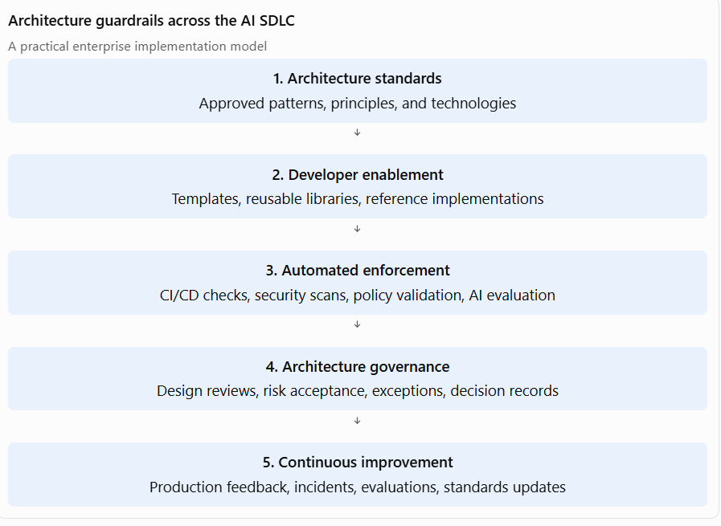

[Home](../index.md) / [Expectation 3](../expectations/03-architecture-standards-guardrails/index.md)

# Appendix: Duplicate Copy of Expectation 3

> This appendix preserves the second copy of Expectation 3 found in the source document, including the repeated tail. The canonical version is [Expectation 3: Architecture standards and guardrails](../expectations/03-architecture-standards-guardrails/index.md).

## 1. Two-paragraph interview narrative

As an AI Principal Architect, I establish and continuously evolve enterprise architecture standards, reference architectures, reusable design patterns, and technical guardrails that enable teams to build AI solutions consistently, securely, and at scale. I collaborate with enterprise architecture, AI engineering, application development, data, security, and business stakeholders to define architectural principles covering AI application design, LLM integration, RAG, agentic AI, model selection, data management, API integration, and responsible AI. I translate emerging AI technologies and enterprise requirements into practical architectural guidance that engineering teams can adopt across products, platforms, and business domains. My objective is to accelerate AI innovation while minimizing architectural fragmentation, duplicated investments, technology risks, and unnecessary complexity.

I also treat architecture standards as evolving assets rather than static documentation. I establish governance mechanisms to validate architectural patterns through implementation experience, AI evaluation results, operational feedback, and changes in technology or regulatory requirements. I define guardrails that guide engineering teams toward approved technologies, secure development practices, reusable components, and appropriate AI risk controls while preserving flexibility for experimentation and innovation. Through architecture reviews, reference implementations, reusable blueprints, developer enablement, and continuous improvement, I ensure that AI-enabled software development follows consistent enterprise principles and that architectural standards remain practical, measurable, and aligned with business objectives.

## 2. Expand each significant point with industry examples

### A. Define enterprise AI architecture standards

#### What this means

Architecture standards establish the common principles, technology choices, engineering practices, and quality requirements that AI solutions must follow across the enterprise.

As an AI Principal Architect, you define standards that provide consistency without forcing every AI solution into an identical implementation.

Typical standards include:

- AI application architecture principles.
- Approved model integration approaches.
- API and service integration standards.
- Data management and information security standards.
- RAG and knowledge retrieval standards.
- AI agent design standards.
- AI evaluation and testing requirements.
- Model lifecycle and operational standards.
- Documentation and architecture decision requirements.
- Responsible AI and compliance requirements.

The objective is to reduce architectural fragmentation, promote reuse, improve quality, and make AI solutions easier to maintain and govern.

#### Example 1: Banking – Standardize AI-powered customer assistants

Business scenario: Multiple banking divisions want to introduce customer-facing AI assistants.

Without standards, each team might independently select an LLM, implement customer data access, and establish its own security mechanisms.

Standards I would establish:

- Approved enterprise LLM access through a model gateway.
- Standard integration with customer and product APIs.
- Customer identity and authorization requirements.
- Standard RAG architecture for approved banking knowledge.
- Evaluation requirements for accuracy and financial misinformation.
- Audit logging and human escalation requirements.

Result: Multiple banking products can use a consistent architecture while retaining their own business-specific capabilities.

#### Example 2: Insurance – Standardize document intelligence

Business scenario: Claims, underwriting, policy servicing, and customer onboarding teams all need document extraction capabilities.

Standards I would establish:

- Common document ingestion and classification patterns.
- Standard extraction APIs and data schemas.
- Confidence scoring and validation requirements.
- Standard exception handling.
- Secure document storage and retention.
- Reusable integration with insurance workflow systems.

Result: Teams reuse document intelligence capabilities rather than developing separate extraction solutions.

#### Example 3: Healthcare – Standardize clinical AI applications

Business scenario: Multiple hospitals want to introduce clinical summarization and knowledge assistants.

Standards I would establish:

- Approved clinical data integration patterns.
- Patient-level access control.
- Clinical data privacy requirements.
- Standard evaluation of clinical accuracy.
- Human review requirements.
- Clinical auditability and traceability.

Result: Healthcare AI applications follow consistent safety and privacy requirements while supporting different clinical workflows.

#### Example 4: Telecommunications – Standardize network AI capabilities

Business scenario: Network operations, customer service, and predictive maintenance teams are introducing AI.

Standards I would establish:

- Common model integration and API standards.
- Standard event-driven integration patterns.
- Reusable network telemetry ingestion.
- Agent tool permission standards.
- Operational observability and monitoring requirements.

Result: AI capabilities can be reused across network operations and customer service platforms.

#### Example 5: Government – Standardize citizen service AI

Business scenario: Multiple departments want to introduce AI assistants for citizen services.

Standards I would establish:

- Approved knowledge source requirements.
- Standard identity and access management.
- API integration with departmental systems.
- Accessibility and multilingual support requirements.
- Data retention and audit requirements.
- Human escalation for sensitive administrative decisions.

Result: Departments can implement AI services consistently while preserving departmental data boundaries.

### B. Establish reusable AI reference architectures and design patterns

#### What this means

A reference architecture provides a reusable architectural blueprint for a particular class of AI solution.

A design pattern provides a repeatable solution to a recurring architectural problem.

The principal architect identifies common AI use cases and establishes patterns that engineering teams can reuse rather than designing each application from scratch.

Examples of reusable AI patterns include:

| **Pattern** | **Purpose** |
| --- | --- |
| Enterprise RAG pattern | Ground AI responses in enterprise knowledge |
| AI model gateway | Centralize model access and control |
| AI agent with tool calling | Enable controlled interaction with business APIs |
| Human-in-the-loop pattern | Introduce human review for consequential decisions |
| Document intelligence pattern | Standardize document extraction and processing |
| AI workflow orchestration | Coordinate AI and deterministic business processes |
| AI evaluation pattern | Establish reusable quality and performance evaluation |
| Event-driven AI pattern | Support asynchronous AI processing |
| AI observability pattern | Monitor AI quality, performance, cost, and behavior |

Microsoft's AI architecture guidance provides useful baseline patterns for intelligent applications, orchestration, knowledge retrieval, and tools integration.

Microsoft Learn+1

#### Example 1: Banking – Enterprise RAG reference architecture

Business scenario: Banking teams want AI assistants for credit policy, customer servicing, compliance, and product information.

Reference architecture:

- Document ingestion and processing.
- Enterprise knowledge repository.
- Embedding and retrieval services.
- Permission-aware retrieval.
- LLM orchestration.
- Response generation with citations.
- Evaluation and monitoring.

Reusable pattern: A common enterprise RAG architecture that supports multiple banking use cases while enforcing data access and knowledge source controls.

#### Example 2: Insurance – Document intelligence pattern

Business scenario: Insurance teams need to extract information from claims forms, medical reports, policy documents, and customer submissions.

Reference architecture:

- Document ingestion.
- Classification.
- OCR and document extraction.
- Validation and confidence scoring.
- Human review.
- Workflow integration.

Reusable pattern: A document intelligence service that can be reused across claims, underwriting, and policy servicing.

#### Example 3: Healthcare – Clinical knowledge assistant pattern

Business scenario: Healthcare professionals need an assistant that retrieves clinical guidelines and authorized patient information.

Reference architecture:

- Identity and authorization.
- Clinical knowledge retrieval.
- Patient context integration.
- LLM-based summarization.
- Source citation.
- Clinician review.

Reusable pattern: A clinical knowledge assistant architecture with strong patient data protection and human oversight.

#### Example 4: Telecommunications – Network operations agent pattern

Business scenario: Telecom operators want AI agents to investigate incidents and recommend remediation.

Reference architecture:

- Event ingestion.
- Network telemetry retrieval.
- Incident analysis.
- Tool calling to monitoring systems.
- Diagnostic recommendations.
- Approval-controlled remediation.
- Audit logging.

Reusable pattern: A controlled AI agent architecture that supports multiple network operations workflows.

#### Example 5: Government – Citizen services assistant pattern

Business scenario: Government departments want AI assistants for citizen information and service navigation.

Reference architecture:

- Approved public knowledge sources.
- Retrieval and grounding.
- Citizen authentication where required.
- Departmental API integration.
- Response validation.
- Human escalation.

Reusable pattern: A citizen services architecture that can be adapted across departments without duplicating core AI capabilities.

### C. Define guardrails for AI solutions and AI-enabled software development

#### What this means

Guardrails are architectural constraints, controls, and engineering practices that guide teams toward safe, secure, reliable, and maintainable AI implementations.

They are not intended to prevent innovation. They establish the boundaries within which teams can innovate responsibly.

A mature enterprise AI guardrail framework should cover the following areas:

AI solution guardrails

- Approved models, providers, and deployment environments.
- Data classification and privacy.
- AI risk classification and responsible AI.
- Retrieval quality and source grounding.
- Model evaluation and validation.
- AI-specific security controls.
- Human oversight and approval.
- Production monitoring and incident management.

AI-enabled software development guardrails

- Approved AI development frameworks and libraries.
- Secure coding practices for AI applications.
- API contracts and integration standards.
- Prompt and configuration versioning.
- Automated testing and AI evaluation.
- CI/CD and deployment controls.
- Dependency and vulnerability scanning.
- Observability and operational readiness.

The distinction is important: AI solution guardrails govern the behavior and risk of AI capabilities, while AI-enabled software development guardrails govern how engineering teams design, build, test, deploy, and maintain those capabilities.

#### Example 1: Banking – Guardrails for AI loan underwriting

Business scenario: A bank introduces AI-assisted loan underwriting.

Guardrails:

- AI-generated recommendations must not bypass established lending policies.
- Approved models and data sources must be used.
- Sensitive customer information must be protected.
- Model fairness and performance must be evaluated.
- High-impact lending decisions must retain appropriate human accountability.
- All relevant recommendations and decisions must be traceable.

Engineering guardrails:

- Use approved APIs for accessing customer information.
- Enforce deterministic eligibility and policy rules.
- Test model outputs against predefined evaluation datasets.
- Apply mandatory approval workflows before consequential actions.

Architectural outcome: AI improves underwriting efficiency without compromising lending controls.

#### Example 2: Insurance – Guardrails for AI claims processing

Business scenario: An insurer introduces AI-assisted claims assessment.

Guardrails:

- Claims information must be retrieved only from authorized sources.
- AI must not invent policy clauses or coverage conditions.
- Low-confidence extraction must trigger human review.
- Claims decisions must remain traceable.
- Customer data must be protected throughout processing.

Engineering guardrails:

- Standard document extraction schemas.
- Confidence thresholds for automated processing.
- Validation against policy and claims systems.
- Mandatory exception handling.
- Automated testing of document extraction accuracy.

Architectural outcome: AI-assisted claims processing becomes more consistent, controlled, and auditable.

#### Example 3: Healthcare – Guardrails for clinical AI

Business scenario: A hospital introduces AI-generated clinical summaries.

Guardrails:

- Clinical information must come from approved and authorized sources.
- AI-generated clinical content must be clearly distinguishable from verified clinical records.
- Clinical accuracy must be evaluated.
- Sensitive patient information must be protected.
- Clinicians must retain appropriate oversight.

Engineering guardrails:

- Secure EHR integration.
- Clinical terminology validation.
- Version-controlled prompts and model configurations.
- Evaluation datasets representing relevant clinical scenarios.
- Logging and traceability of AI-generated outputs.

Architectural outcome: Clinical AI supports healthcare professionals while preserving clinical responsibility and patient safety.

#### Example 4: Telecommunications – Guardrails for autonomous network agents

Business scenario: A telecom operator introduces AI agents for network incident remediation.

Guardrails:

- Agents must use approved operational tools.
- Tool permissions must follow least privilege.
- Network-changing actions must have appropriate approval.
- Agent actions must be logged and monitored.
- High-risk actions must have rollback mechanisms.

Engineering guardrails:

- Standardized tool contracts.
- Input validation for tool calls.
- Controlled execution environments.
- Integration testing against simulated network scenarios.
- Monitoring for unexpected agent behavior.

Architectural outcome: Network automation becomes more intelligent without introducing uncontrolled operational risk.

#### Example 5: Government – Guardrails for AI-enabled citizen services

Business scenario: Government departments deploy AI assistants that help citizens access public services.

Guardrails:

- Responses must use approved information sources.
- Sensitive citizen information must be protected.
- Department-specific access boundaries must be enforced.
- AI must not independently make unauthorized administrative decisions.
- Human escalation must be available for complex or sensitive cases.

Engineering guardrails:

- Approved knowledge repositories.
- Standard API authentication and authorization.
- Content validation and response evaluation.
- Accessibility and multilingual testing.
- Audit logging and retention controls.

Architectural outcome: Citizen services become more accessible while maintaining transparency, security, and public accountability.

### D. Embed architecture guardrails into the software development lifecycle

#### What this means

A Principal Architect should ensure that architecture standards are embedded into the development process rather than relying solely on documentation or architecture review meetings.

This is where architecture governance becomes engineering enablement.

The goal is to make the correct architectural approach the easiest approach for engineering teams to follow.

#### Recommended implementation approach

#### Example 1: Banking – Standardized AI application development

Develop a reusable AI application starter kit containing:

- Approved LLM integration.
- Authentication and authorization.
- Prompt management.
- Logging and monitoring.
- Standard API integration.
- Automated security checks.

Engineering teams use the starter kit instead of building these components independently.

#### Example 2: Insurance – Automated AI quality checks

Introduce CI/CD pipeline checks for AI claims applications.

The pipeline validates:

- Approved model versions.
- Prompt and configuration changes.
- Document extraction accuracy.
- RAG retrieval quality.
- Security and privacy requirements.
- Regression evaluation results.

This makes architecture and AI quality standards part of the delivery process.

#### Example 3: Healthcare – AI development governance

Establish a controlled development process for clinical AI applications.

The pipeline includes:

- Clinical evaluation datasets.
- Model and prompt version tracking.
- Privacy and security checks.
- Clinical review requirements.
- Release approval.
- Production monitoring.

This ensures that clinical AI changes receive appropriate validation before deployment.

#### Example 4: Telecommunications – Agent development guardrails

Provide standardized agent development templates with:

- Approved tool registration.
- Tool permission definitions.
- Agent execution limits.
- Input and output validation.
- Human approval mechanisms.
- Audit logging.

This allows different teams to develop agents while maintaining consistent controls.

#### Example 5: Government – Architecture compliance automation

Develop reusable compliance checks for citizen-facing AI applications.

Automated checks validate:

- Approved knowledge sources.
- API authentication.
- Data access permissions.
- Logging and retention requirements.
- Accessibility requirements.
- Deployment configuration.

Architecture reviews can then focus on complex design decisions rather than repetitive compliance checks.

### E. Continuously evolve architecture standards based on technology, business, and operational feedback

#### What this means

AI architecture standards cannot remain static because models, frameworks, security threats, business requirements, and regulatory expectations change rapidly.

The Principal Architect must establish a structured process to review, validate, and evolve standards based on:

- New AI technologies and capabilities.
- Emerging architectural patterns.
- Production incidents and operational feedback.
- Model evaluation results.
- Security vulnerabilities.
- Business requirements.
- Cloud and platform changes.
- Regulatory and compliance requirements.
- Engineering feedback and implementation challenges.

The goal is to maintain architectural consistency without creating outdated standards that constrain innovation.

#### Example 1: Banking – Evolve model selection standards

Initially, the organization may standardize on a single LLM provider.

Over time, new models may offer better reasoning, lower latency, improved cost efficiency, or stronger privacy capabilities.

I would establish a model evaluation framework that assesses:

- Accuracy and reasoning quality.
- Security and data protection.
- Latency and throughput.
- Cost per interaction.
- Business suitability.
- Operational reliability.

Based on evaluation results, I would evolve the model standards to support approved multi-model routing rather than relying on a single provider.

#### Example 2: Insurance – Evolve document processing patterns

Production feedback reveals that document extraction performs well for standard claims but struggles with handwritten forms and complex attachments.

I would evolve the reference pattern to include:

- Improved document classification.
- Specialized extraction models.
- Confidence-based routing.
- Human review for uncertain results.
- Continuous evaluation of extraction quality.

The architecture evolves based on operational evidence rather than theoretical assumptions.

#### Example 3: Healthcare – Evolve clinical AI evaluation standards

New clinical AI use cases introduce additional safety and accuracy considerations.

I would update standards to include:

- Domain-specific evaluation datasets.
- Clinical validation requirements.
- Improved source grounding.
- Human review requirements.
- More comprehensive error and risk monitoring.

This ensures that architectural standards reflect the increasing risk and complexity of clinical AI applications.

#### Example 4: Telecommunications – Evolve AI agent standards

Initially, AI agents may only provide diagnostic recommendations.

Later, business teams may want agents to execute operational actions.

I would evolve agent architecture standards to introduce:

- Tool permission tiers.
- Action risk classification.
- Human approval for high-impact operations.
- Execution limits.
- Rollback mechanisms.
- Enhanced monitoring and auditability.

This allows agent capabilities to expand without compromising operational safety.

#### Example 5: Government – Evolve AI governance standards

As AI services expand across government departments, new requirements may emerge around privacy, transparency, accessibility, and accountability.

I would review architecture standards and update:

- AI risk classification.
- Approved data handling patterns.
- Knowledge source validation.
- Audit and traceability requirements.
- Human oversight requirements.
- Accessibility and multilingual design standards.

The architecture governance process ensures that new requirements are incorporated consistently across departmental solutions.

### F. Promote architecture standards through developer enablement and governance

#### What this means

Defining architecture standards is only one part of the role. A Principal Architect must ensure that teams understand, adopt, and consistently apply those standards.

This involves creating an architecture enablement ecosystem comprising:

- Architecture playbooks.
- Reference implementations.
- Reusable code templates.
- AI engineering guidelines.
- Architecture decision records.
- Developer training.
- Design review forums.
- Exception management.
- Architecture compliance dashboards.

The objective is to make architecture guidance accessible, actionable, and measurable.

#### Five industry examples

| **Industry** | **Architecture enablement approach** | **Expected benefit** |
| --- | --- | --- |
| Banking | Reusable AI application templates with secure model gateway integration | Faster delivery and consistent security |
| Insurance | Shared document intelligence libraries and claims integration patterns | Reduced duplication and implementation effort |
| Healthcare | Clinical AI reference implementations and evaluation templates | Consistent clinical validation and privacy controls |
| Telecommunications | Standard agent development framework and tool integration templates | Faster agent development and controlled operations |
| Government | AI architecture playbooks, compliance checklists, and departmental reference patterns | Consistent governance across departments |

Interview talking point:

I view architecture standards as a product for engineering teams. I focus on making them easy to understand, easy to adopt, and measurable through automated controls. Rather than relying exclusively on governance meetings, I promote reusable templates, reference implementations, and automated compliance checks that help teams build the right solutions from the beginning.

## 3. Preparation guide with links

For an AI Principal Architect interview, prepare to explain not only what standards and patterns you would establish, but also how you would implement, govern, and evolve them across enterprise teams.

### A. AI architecture standards and reference architectures

| **Topic** | **What to study** | **Preparation resource** |
| --- | --- | --- |
| AI reference architecture | AI application layers, model access, orchestration, knowledge, tools | [Microsoft AI Architecture Patterns](https://learn.microsoft.com/en-us/azure/well-architected/ai/architecture-pattern?utm_source=chatgpt.com) |
| Enterprise AI architecture | Shared platforms, AI services, reusable architecture | [AWS Enterprise-Ready GenAI Platform](https://docs.aws.amazon.com/prescriptive-guidance/latest/strategy-enterprise-ready-gen-ai-platform/?utm_source=chatgpt.com) |
| AI design patterns | RAG, model gateway, agents, event-driven AI, human-in-the-loop | [Microsoft AI Application Design Patterns](https://learn.microsoft.com/en-us/azure/well-architected/ai/application-design?utm_source=chatgpt.com) |
| AI architecture principles | Security, reliability, performance, cost, operational excellence | [Azure AI Design Principles](https://learn.microsoft.com/en-us/azure/well-architected/ai/design-principles?utm_source=chatgpt.com) |

Microsoft's AI architecture guidance is a useful starting point for understanding how to structure reusable AI architecture patterns across application, orchestration, knowledge, and tools layers.

Microsoft Learn+1

#### Interview questions to prepare:

1. How would you establish enterprise AI architecture standards?
1. How do you decide which AI capabilities should be standardized?
1. How would you define an AI reference architecture for a large organization?
1. How would you prevent different teams from creating incompatible AI architectures?
1. How would you balance architectural consistency with innovation?

### B. AI security and architecture guardrails

| **Topic** | **What to study** | **Preparation resource** |
| --- | --- | --- |
| AI risk management | Risk classification, risk assessment, mitigation, lifecycle governance | [NIST AI Risk Management Framework](https://www.nist.gov/itl/ai-risk-management-framework?utm_source=chatgpt.com) |
| AI security verification | Security requirements for AI systems and lifecycle controls | [OWASP AI Security Verification Standard](https://owasp.org/projects/artificial-intelligence-security-verification-standard-aisvs-docs?utm_source=chatgpt.com) |
| AI security architecture | AI security, privacy, responsible AI, operational controls | [Microsoft AI Design Principles](https://learn.microsoft.com/en-us/azure/well-architected/ai/design-principles?utm_source=chatgpt.com) |
| Zero Trust for AI | Identity, access control, trust boundaries, agent security | [Microsoft Zero Trust for AI](https://www.microsoft.com/en-us/security/blog/2026/03/19/new-tools-and-guidance-announcing-zero-trust-for-ai/?utm_source=chatgpt.com) |

NIST AI RMF provides a lifecycle-oriented framework for managing AI risks, while OWASP AISVS offers testable security requirements for AI-enabled systems.

NIST+1

#### Interview questions to prepare:

1. How would you define guardrails for enterprise AI development?
1. How would you prevent sensitive data from being exposed through RAG?
1. How would you govern AI agent tool access?
1. How would you incorporate AI security into CI/CD?
1. How would you enforce guardrails without slowing down delivery?

### C. AI-enabled software development and engineering governance

| **Topic** | **What to study** | **Preparation resource** |
| --- | --- | --- |
| Architecture governance | Architecture reviews, standards, decision records, exceptions | [TOGAF Enterprise Architecture](https://www.opengroup.org/togaf?utm_source=chatgpt.com) |
| API design | API contracts, versioning, integration standards | [Microsoft API Design Best Practices](https://learn.microsoft.com/en-us/azure/architecture/best-practices/api-design?utm_source=chatgpt.com) |
| Cloud architecture governance | Reliability, security, performance, operational excellence | [Azure Well-Architected Framework](https://learn.microsoft.com/en-us/azure/architecture/framework/?utm_source=chatgpt.com) |
| AI application engineering | Application patterns, RAG, orchestration, deployment | [AI Application Design](https://learn.microsoft.com/en-us/azure/well-architected/ai/application-design?utm_source=chatgpt.com) |

The Azure Well-Architected Framework is particularly useful for explaining how standards can be translated into engineering practices for reliability, security, cost optimization, operational excellence, and performance.

Microsoft Learn+1

#### Interview questions to prepare:

1. How would you embed architecture standards into the software development lifecycle?
1. How would you automate architecture compliance?
1. How do you handle exceptions to enterprise architecture standards?
1. How would you measure architecture adoption across teams?
1. How would you manage architecture technical debt?

## 4. Practical interview case study

Prepare a case study that demonstrates how you would establish architecture standards for a large enterprise AI program.

#### Scenario: Enterprise AI architecture standards for a banking organization

A bank plans to introduce AI applications across:

- Customer service.
- Loan underwriting.
- Fraud monitoring.
- Cross-selling.
- Compliance monitoring.
- Employee knowledge management.

The bank currently has multiple development teams independently building AI applications.

#### Your architectural responsibilities

| **Step** | **What you should explain** |
| --- | --- |
| 1. Assess current state | Identify existing AI solutions, duplicated capabilities, security gaps, and technology fragmentation |
| 2. Define architecture principles | Establish principles for security, reuse, scalability, interoperability, and responsible AI |
| 3. Develop reference architectures | Define standard RAG, agentic AI, document intelligence, and AI integration patterns |
| 4. Establish guardrails | Define model approval, data security, AI evaluation, and agent permission controls |
| 5. Enable engineering teams | Provide reusable templates, libraries, APIs, and reference implementations |
| 6. Automate governance | Introduce CI/CD architecture checks, AI evaluations, and security validation |
| 7. Establish governance | Define architecture review forums, decision records, and exception management |
| 8. Evolve standards | Incorporate production feedback, incidents, new technologies, and changing requirements |

## 5. Metrics to demonstrate architecture effectiveness

A Principal Architect should demonstrate that architecture standards improve enterprise delivery and quality.

| **Metric** | **What it measures** |
| --- | --- |
| Architecture adoption rate | Percentage of AI projects using approved patterns |
| Reuse rate | Percentage of solutions leveraging shared AI capabilities |
| Time-to-market | Reduction in AI application delivery time |
| Architecture compliance | Compliance with mandatory standards and guardrails |
| Security findings | AI-related security issues identified and resolved |
| AI quality | Accuracy, retrieval quality, and evaluation results |
| Operational reliability | Availability, failure rates, and incident frequency |
| Cost efficiency | Reduction in duplicated infrastructure and AI service costs |
| Exception rate | Frequency of architecture deviations and waivers |

These metrics help demonstrate that architecture governance is an enabler of innovation rather than simply a control mechanism.

## 6. Strong interview closing statement

Use this as your final summary when discussing the expectation:

#### Example 1: Banking – Standardized AI application development

Develop a reusable AI application starter kit containing:

- Approved LLM integration.
- Authentication and authorization.
- Prompt management.
- Logging and monitoring.
- Standard API integration.
- Automated security checks.

Engineering teams use the starter kit instead of building these components independently.

#### Example 2: Insurance – Automated AI quality checks

Introduce CI/CD pipeline checks for AI claims applications.

The pipeline validates:

- Approved model versions.
- Prompt and configuration changes.
- Document extraction accuracy.
- RAG retrieval quality.
- Security and privacy requirements.
- Regression evaluation results.

This makes architecture and AI quality standards part of the delivery process.

#### Example 3: Healthcare – AI development governance

Establish a controlled development process for clinical AI applications.

The pipeline includes:

- Clinical evaluation datasets.
- Model and prompt version tracking.
- Privacy and security checks.
- Clinical review requirements.
- Release approval.
- Production monitoring.

This ensures that clinical AI changes receive appropriate validation before deployment.

#### Example 4: Telecommunications – Agent development guardrails

Provide standardized agent development templates with:

- Approved tool registration.
- Tool permission definitions.
- Agent execution limits.
- Input and output validation.
- Human approval mechanisms.
- Audit logging.

This allows different teams to develop agents while maintaining consistent controls.

#### Example 5: Government – Architecture compliance automation

Develop reusable compliance checks for citizen-facing AI applications.

Automated checks validate:

- Approved knowledge sources.
- API authentication.
- Data access permissions.
- Logging and retention requirements.
- Accessibility requirements.
- Deployment configuration.

Architecture reviews can then focus on complex design decisions rather than repetitive compliance checks.

### E. Continuously evolve architecture standards based on technology, business, and operational feedback

#### What this means

AI architecture standards cannot remain static because models, frameworks, security threats, business requirements, and regulatory expectations change rapidly.

The Principal Architect must establish a structured process to review, validate, and evolve standards based on:

- New AI technologies and capabilities.
- Emerging architectural patterns.
- Production incidents and operational feedback.
- Model evaluation results.
- Security vulnerabilities.
- Business requirements.
- Cloud and platform changes.
- Regulatory and compliance requirements.
- Engineering feedback and implementation challenges.

The goal is to maintain architectural consistency without creating outdated standards that constrain innovation.

#### Example 1: Banking – Evolve model selection standards

Initially, the organization may standardize on a single LLM provider.

Over time, new models may offer better reasoning, lower latency, improved cost efficiency, or stronger privacy capabilities.

I would establish a model evaluation framework that assesses:

- Accuracy and reasoning quality.
- Security and data protection.
- Latency and throughput.
- Cost per interaction.
- Business suitability.
- Operational reliability.

Based on evaluation results, I would evolve the model standards to support approved multi-model routing rather than relying on a single provider.

#### Example 2: Insurance – Evolve document processing patterns

Production feedback reveals that document extraction performs well for standard claims but struggles with handwritten forms and complex attachments.

I would evolve the reference pattern to include:

- Improved document classification.
- Specialized extraction models.
- Confidence-based routing.
- Human review for uncertain results.
- Continuous evaluation of extraction quality.

The architecture evolves based on operational evidence rather than theoretical assumptions.

#### Example 3: Healthcare – Evolve clinical AI evaluation standards

New clinical AI use cases introduce additional safety and accuracy considerations.

I would update standards to include:

- Domain-specific evaluation datasets.
- Clinical validation requirements.
- Improved source grounding.
- Human review requirements.
- More comprehensive error and risk monitoring.

This ensures that architectural standards reflect the increasing risk and complexity of clinical AI applications.

#### Example 4: Telecommunications – Evolve AI agent standards

Initially, AI agents may only provide diagnostic recommendations.

Later, business teams may want agents to execute operational actions.

I would evolve agent architecture standards to introduce:

- Tool permission tiers.
- Action risk classification.
- Human approval for high-impact operations.
- Execution limits.
- Rollback mechanisms.
- Enhanced monitoring and auditability.

This allows agent capabilities to expand without compromising operational safety.

#### Example 5: Government – Evolve AI governance standards

As AI services expand across government departments, new requirements may emerge around privacy, transparency, accessibility, and accountability.

I would review architecture standards and update:

- AI risk classification.
- Approved data handling patterns.
- Knowledge source validation.
- Audit and traceability requirements.
- Human oversight requirements.
- Accessibility and multilingual design standards.

The architecture governance process ensures that new requirements are incorporated consistently across departmental solutions.

### F. Promote architecture standards through developer enablement and governance

#### What this means

Defining architecture standards is only one part of the role. A Principal Architect must ensure that teams understand, adopt, and consistently apply those standards.

This involves creating an architecture enablement ecosystem comprising:

- Architecture playbooks.
- Reference implementations.
- Reusable code templates.
- AI engineering guidelines.
- Architecture decision records.
- Developer training.
- Design review forums.
- Exception management.
- Architecture compliance dashboards.

The objective is to make architecture guidance accessible, actionable, and measurable.

#### Five industry examples

| **Industry** | **Architecture enablement approach** | **Expected benefit** |
| --- | --- | --- |
| Banking | Reusable AI application templates with secure model gateway integration | Faster delivery and consistent security |
| Insurance | Shared document intelligence libraries and claims integration patterns | Reduced duplication and implementation effort |
| Healthcare | Clinical AI reference implementations and evaluation templates | Consistent clinical validation and privacy controls |
| Telecommunications | Standard agent development framework and tool integration templates | Faster agent development and controlled operations |
| Government | AI architecture playbooks, compliance checklists, and departmental reference patterns | Consistent governance across departments |

Interview talking point:

I view architecture standards as a product for engineering teams. I focus on making them easy to understand, easy to adopt, and measurable through automated controls. Rather than relying exclusively on governance meetings, I promote reusable templates, reference implementations, and automated compliance checks that help teams build the right solutions from the beginning.

## 3. Preparation guide with links

For an AI Principal Architect interview, prepare to explain not only what standards and patterns you would establish, but also how you would implement, govern, and evolve them across enterprise teams.

### A. AI architecture standards and reference architectures

| **Topic** | **What to study** | **Preparation resource** |
| --- | --- | --- |
| AI reference architecture | AI application layers, model access, orchestration, knowledge, tools | [Microsoft AI Architecture Patterns](https://learn.microsoft.com/en-us/azure/well-architected/ai/architecture-pattern?utm_source=chatgpt.com) |
| Enterprise AI architecture | Shared platforms, AI services, reusable architecture | [AWS Enterprise-Ready GenAI Platform](https://docs.aws.amazon.com/prescriptive-guidance/latest/strategy-enterprise-ready-gen-ai-platform/?utm_source=chatgpt.com) |
| AI design patterns | RAG, model gateway, agents, event-driven AI, human-in-the-loop | [Microsoft AI Application Design Patterns](https://learn.microsoft.com/en-us/azure/well-architected/ai/application-design?utm_source=chatgpt.com) |
| AI architecture principles | Security, reliability, performance, cost, operational excellence | [Azure AI Design Principles](https://learn.microsoft.com/en-us/azure/well-architected/ai/design-principles?utm_source=chatgpt.com) |

Microsoft's AI architecture guidance is a useful starting point for understanding how to structure reusable AI architecture patterns across application, orchestration, knowledge, and tools layers.

Microsoft Learn+1

#### Interview questions to prepare:

1. How would you establish enterprise AI architecture standards?
1. How do you decide which AI capabilities should be standardized?
1. How would you define an AI reference architecture for a large organization?
1. How would you prevent different teams from creating incompatible AI architectures?
1. How would you balance architectural consistency with innovation?

### B. AI security and architecture guardrails

| **Topic** | **What to study** | **Preparation resource** |
| --- | --- | --- |
| AI risk management | Risk classification, risk assessment, mitigation, lifecycle governance | [NIST AI Risk Management Framework](https://www.nist.gov/itl/ai-risk-management-framework?utm_source=chatgpt.com) |
| AI security verification | Security requirements for AI systems and lifecycle controls | [OWASP AI Security Verification Standard](https://owasp.org/projects/artificial-intelligence-security-verification-standard-aisvs-docs?utm_source=chatgpt.com) |
| AI security architecture | AI security, privacy, responsible AI, operational controls | [Microsoft AI Design Principles](https://learn.microsoft.com/en-us/azure/well-architected/ai/design-principles?utm_source=chatgpt.com) |
| Zero Trust for AI | Identity, access control, trust boundaries, agent security | [Microsoft Zero Trust for AI](https://www.microsoft.com/en-us/security/blog/2026/03/19/new-tools-and-guidance-announcing-zero-trust-for-ai/?utm_source=chatgpt.com) |

NIST AI RMF provides a lifecycle-oriented framework for managing AI risks, while OWASP AISVS offers testable security requirements for AI-enabled systems.

NIST+1

#### Interview questions to prepare:

1. How would you define guardrails for enterprise AI development?
1. How would you prevent sensitive data from being exposed through RAG?
1. How would you govern AI agent tool access?
1. How would you incorporate AI security into CI/CD?
1. How would you enforce guardrails without slowing down delivery?

### C. AI-enabled software development and engineering governance

| **Topic** | **What to study** | **Preparation resource** |
| --- | --- | --- |
| Architecture governance | Architecture reviews, standards, decision records, exceptions | [TOGAF Enterprise Architecture](https://www.opengroup.org/togaf?utm_source=chatgpt.com) |
| API design | API contracts, versioning, integration standards | [Microsoft API Design Best Practices](https://learn.microsoft.com/en-us/azure/architecture/best-practices/api-design?utm_source=chatgpt.com) |
| Cloud architecture governance | Reliability, security, performance, operational excellence | [Azure Well-Architected Framework](https://learn.microsoft.com/en-us/azure/architecture/framework/?utm_source=chatgpt.com) |
| AI application engineering | Application patterns, RAG, orchestration, deployment | [AI Application Design](https://learn.microsoft.com/en-us/azure/well-architected/ai/application-design?utm_source=chatgpt.com) |

The Azure Well-Architected Framework is particularly useful for explaining how standards can be translated into engineering practices for reliability, security, cost optimization, operational excellence, and performance.

Microsoft Learn+1

#### Interview questions to prepare:

1. How would you embed architecture standards into the software development lifecycle?
1. How would you automate architecture compliance?
1. How do you handle exceptions to enterprise architecture standards?
1. How would you measure architecture adoption across teams?
1. How would you manage architecture technical debt?

## 4. Practical interview case study

Prepare a case study that demonstrates how you would establish architecture standards for a large enterprise AI program.

#### Scenario: Enterprise AI architecture standards for a banking organization

A bank plans to introduce AI applications across:

- Customer service.
- Loan underwriting.
- Fraud monitoring.
- Cross-selling.
- Compliance monitoring.
- Employee knowledge management.

The bank currently has multiple development teams independently building AI applications.

#### Your architectural responsibilities

| **Step** | **What you should explain** |
| --- | --- |
| 1. Assess current state | Identify existing AI solutions, duplicated capabilities, security gaps, and technology fragmentation |
| 2. Define architecture principles | Establish principles for security, reuse, scalability, interoperability, and responsible AI |
| 3. Develop reference architectures | Define standard RAG, agentic AI, document intelligence, and AI integration patterns |
| 4. Establish guardrails | Define model approval, data security, AI evaluation, and agent permission controls |
| 5. Enable engineering teams | Provide reusable templates, libraries, APIs, and reference implementations |
| 6. Automate governance | Introduce CI/CD architecture checks, AI evaluations, and security validation |
| 7. Establish governance | Define architecture review forums, decision records, and exception management |
| 8. Evolve standards | Incorporate production feedback, incidents, new technologies, and changing requirements |

## 5. Metrics to demonstrate architecture effectiveness

A Principal Architect should demonstrate that architecture standards improve enterprise delivery and quality.

| **Metric** | **What it measures** |
| --- | --- |
| Architecture adoption rate | Percentage of AI projects using approved patterns |
| Reuse rate | Percentage of solutions leveraging shared AI capabilities |
| Time-to-market | Reduction in AI application delivery time |
| Architecture compliance | Compliance with mandatory standards and guardrails |
| Security findings | AI-related security issues identified and resolved |
| AI quality | Accuracy, retrieval quality, and evaluation results |
| Operational reliability | Availability, failure rates, and incident frequency |
| Cost efficiency | Reduction in duplicated infrastructure and AI service costs |
| Exception rate | Frequency of architecture deviations and waivers |

These metrics help demonstrate that architecture governance is an enabler of innovation rather than simply a control mechanism.

## 6. Strong interview closing statement

Use this as your final summary when discussing the expectation:

My role as an AI Principal Architect is to act as a strategic technology advisor, helping the organization make informed decisions about emerging AI technologies, platforms, and architectural patterns. I evaluate innovations based on business value, technical maturity, scalability, security, integration complexity, cost, and long-term enterprise fit. I work closely with business leaders, product teams, and engineering stakeholders to identify where AI can deliver meaningful outcomes and determine the most appropriate adoption approach. Through structured technology assessments, proof-of-concepts, reference architectures, and phased adoption roadmaps, I help the organization move from experimentation to production in a controlled and scalable manner. My objective is to ensure that AI investments create sustainable business value while maintaining architectural integrity, responsible AI practices, and enterprise readiness.

## Navigation

- [Canonical Expectation 3](../expectations/03-architecture-standards-guardrails/index.md)
- [Main index](../index.md)
