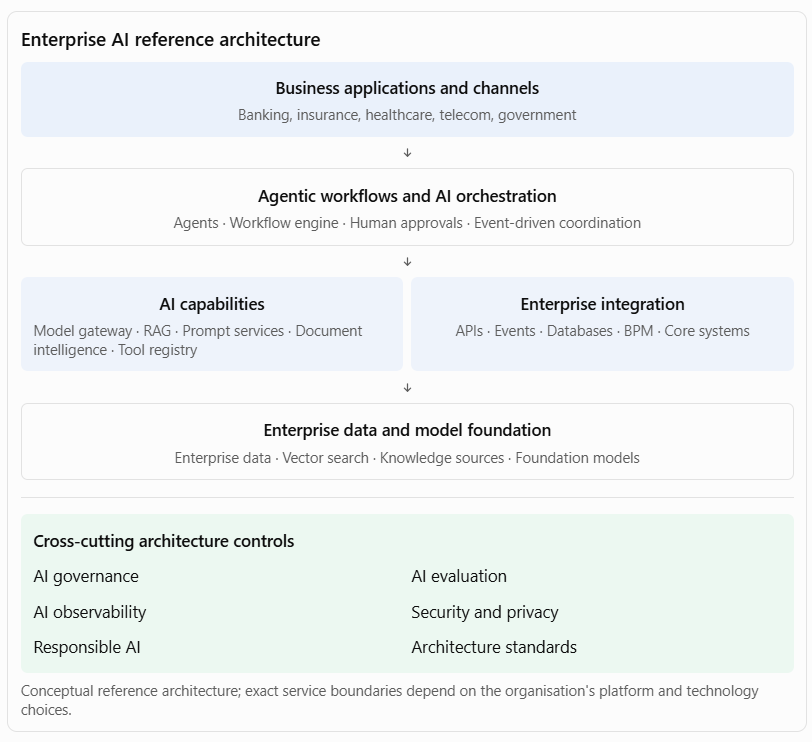

[Home](../../index.md) / [Expectation 4](index.md)

# 2. How the six capabilities fit together

> Part of Expectation 4: Provide architectural leadership for capabilities, agentic workflows, AI orchestration, evaluations, AI observability, and AI governance

At Principal Architect level, the interviewer will expect you to explain how these capabilities form one coherent enterprise architecture.

The important architectural principle is that evaluation, observability, and governance are not isolated components at the bottom of the stack. They apply across the entire lifecycle and every layer.

For example, when a loan-processing agent invokes a credit API:

- Orchestration controls the sequence of activities.
- AI capabilities provide extraction, retrieval, and reasoning.
- Enterprise integration invokes the credit API.
- Evaluation measures extraction and recommendation quality.
- Observability records the execution path, latency, failures, and cost.
- Governance enforces permissions, approval requirements, and auditability.

## 3. Architectural decisions you should be ready to defend

A Principal Architect is expected to make trade-offs, not simply list technologies.

| **Decision** | **Architectural position** |
| --- | --- |
| Agent vs. deterministic workflow | Use agents for bounded reasoning; workflow engines for predictable process control |
| Single agent vs. multi-agent | Start with one agent; introduce multiple agents only where specialisation or isolation justifies the overhead |
| Centralised vs. distributed AI capabilities | Centralise shared platform services and standards; allow domain teams controlled autonomy |
| RAG vs. fine-tuning | Use RAG for frequently changing or access-controlled knowledge; fine-tune for suitable behavioural or task adaptation |
| Model selection | Select against quality, latency, security, cost, availability, and deployment constraints |
| Synchronous vs. asynchronous execution | Use synchronous interaction for short tasks; durable asynchronous execution for long-running workflows |
| Full autonomy vs. human oversight | Set autonomy according to risk, reversibility, impact, and accountability |
| Centralised vs. embedded evaluation | Provide shared evaluation infrastructure, with domain-specific acceptance criteria owned by business teams |
| Detailed logging vs. data minimisation | Capture sufficient diagnostic evidence while masking sensitive information and enforcing retention controls |

A useful architecture principle to articulate: AI should augment enterprise processes without weakening established controls around identity, transaction integrity, data access, business rules, and accountability.

## Page navigation

- Previous: [1. Expand the key responsibilities](responsibilities.md)
- Next: [4. Practical interview case study: Enterprise AI platform for a bank](exercises.md)
- [Back to Expectation 4](index.md)
- [Main index](../../index.md)
