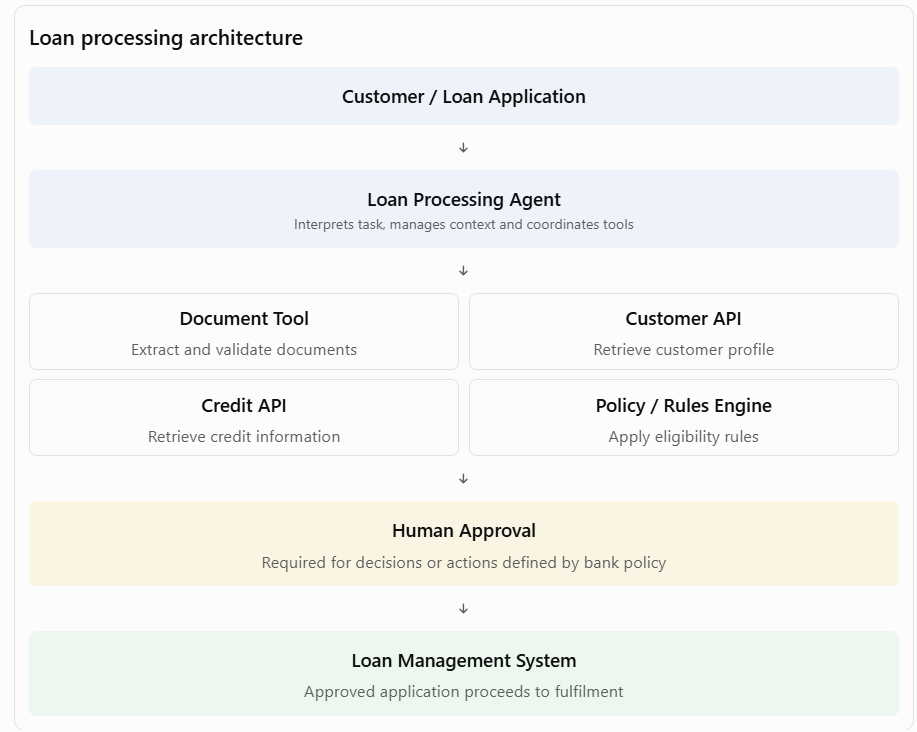
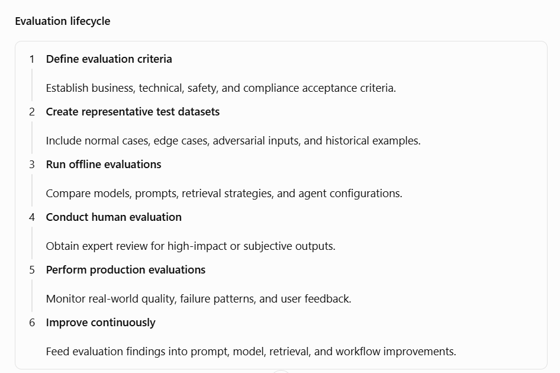
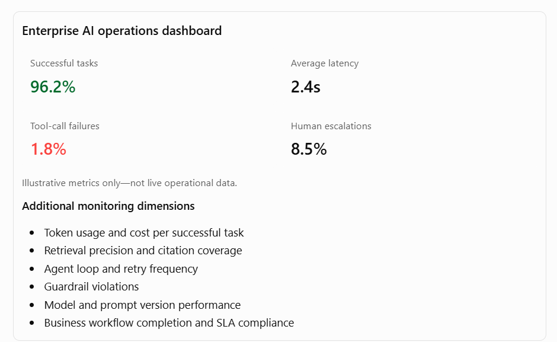

[Home](../../index.md) / [Expectation 4](index.md)

# 1. Expand the key responsibilities

> Part of Expectation 4: Provide architectural leadership for capabilities, agentic workflows, AI orchestration, evaluations, AI observability, and AI governance

### A. Establish reusable enterprise AI capabilities

#### What this means

Rather than allowing every product team to independently implement LLM integration, prompt management, retrieval, document processing, model access, and agent functionality, establish a common set of enterprise AI capabilities.

These capabilities become shared building blocks that product and engineering teams can consume through APIs, SDKs, and approved architectural patterns.

Key capabilities to define include:

#### 1. Model access and management

- Centralised access to approved foundation models.
- Model selection based on capability, latency, cost, and risk.
- Model version management and controlled upgrades.
- Support for cloud-hosted and privately deployed models.

#### 2. Prompt management

- Centralised prompt templates and versioning.
- Prompt testing and approval workflows.
- Environment-specific prompt configuration.
- Protection against prompt injection and unsafe instructions.

#### 3. Enterprise retrieval services

- Document ingestion and preprocessing.
- Chunking, embedding generation, and vector indexing.
- Hybrid search and reranking.
- Metadata filtering and document-level access control.

#### 4. Enterprise AI APIs

- Standard APIs for summarisation, classification, extraction, translation, and question answering.
- Consistent authentication, authorisation, rate limiting, and audit logging.
- Reusable interfaces for application teams.

#### 5. Agent and tool services

- Standard interfaces for agents to access enterprise APIs.
- Tool registration, discovery, and authorisation.
- Approved tools for customer lookup, payment status, claims, loan applications, and workflow execution.

Industry examples

| **Industry** | **Reusable AI capability** | **Business application** |
| --- | --- | --- |
| Banking | Document intelligence, RAG, model gateway | Loan processing, customer support, compliance |
| Insurance | Claims document extraction, image analysis | Claims assessment, underwriting |
| Healthcare | Clinical document retrieval, summarisation | Clinical assistance, patient engagement |
| Telecommunications | Knowledge retrieval, network-event analysis | Customer support, network operations |
| Government | Multilingual document processing, citizen-service APIs | Application processing, citizen support |

Principal Architect perspective: I would establish a shared AI capability platform with clear service boundaries, ownership, SLAs, security controls, consumption models, and adoption guidelines. This reduces duplication and allows teams to focus on business-specific innovation.

### B. Architect agentic workflows

#### What this means

An agentic workflow uses one or more AI agents to interpret objectives, decide which actions are required, invoke approved tools, maintain context, and coordinate work toward a defined outcome.

The important architectural distinction is that an agent should not be treated as an unrestricted autonomous application. Its authority, tools, data access, decision boundaries, and escalation conditions must be explicitly designed.

#### Key architectural decisions include:

#### 1. Agent responsibility and boundaries

- Define the business objective of each agent.
- Separate reasoning from deterministic business rules.
- Define what the agent can decide and what requires human approval.

#### 2. Tool integration

- Expose enterprise functionality through controlled APIs or tool interfaces.
- Define input/output schemas and validation.
- Apply authentication, authorisation, and transaction controls.

#### 3. Workflow state management

- Maintain the state of long-running tasks.
- Support retries, timeouts, resumability, and exception handling.
- Persist decisions and execution history.

#### 4. Human-in-the-loop controls

- Introduce approval checkpoints for high-impact actions.
- Escalate low-confidence or exceptional cases.
- Allow authorised users to review and override decisions.

#### 5. Agent collaboration

- Use specialised agents only when separation of responsibility creates a clear benefit.
- Define communication protocols and hand-off conditions.
- Avoid unnecessary multi-agent complexity.

Industry examples

| **Industry** | **Agentic workflow** | **Example execution** |
| --- | --- | --- |
| Banking | Loan processing agent | Collect documents → verify information → retrieve credit data → assess eligibility → route for approval |
| Insurance | Claims processing agent | Register claim → analyse documents and images → check policy → identify discrepancies → recommend settlement |
| Healthcare | Patient coordination agent | Review appointment request → check availability → retrieve relevant records → coordinate scheduling → escalate clinical decisions |
| Telecommunications | Service resolution agent | Identify issue → inspect network status → run diagnostics → execute permitted remediation → escalate unresolved incidents |
| Government | Citizen application agent | Receive application → validate documents → check eligibility rules → identify missing information → route for authorised decision |

#### Example: Banking loan approval agentic workflow

The agent coordinates the process, but authoritative eligibility rules, credit decisions, and financial transactions remain subject to approved business controls. This separation is critical in regulated environments.

### C. Define enterprise AI orchestration architecture

#### What this means

AI orchestration coordinates models, agents, retrieval systems, enterprise APIs, business workflows, and human approvals to complete an end-to-end business process.

The Principal Architect must decide which orchestration approach is appropriate for each use case.

Important architectural patterns include:

1. Sequential orchestration: Tasks execute in a predefined sequence.
1. Parallel orchestration: Independent tasks execute concurrently.
1. Conditional orchestration: Workflow branches based on rules or model outputs.
1. Supervisor-worker pattern: A supervisor agent delegates work to specialised agents.
1. Human-in-the-loop orchestration: A human decision or approval is required before proceeding.
1. Event-driven orchestration: Events trigger agent or workflow execution.
1. Durable orchestration: Long-running workflows persist state and recover from failures.

Industry examples

| **Industry** | **Orchestration pattern** | **Example** |
| --- | --- | --- |
| Banking | Sequential + human approval | Loan application assessment |
| Insurance | Parallel + conditional | Concurrent policy, document, and fraud checks |
| Healthcare | Human-in-the-loop | Clinical documentation and review |
| Telecommunications | Event-driven | Network incident detection and remediation |
| Government | Durable workflow | Multi-stage citizen application processing |

Architectural decision: Agent versus workflow engine

A common interview question is: Should an agent control the entire process, or should a workflow engine orchestrate the process?

My approach would be:

- Use a workflow engine for deterministic steps, approvals, SLAs, retries, and process state.
- Use an AI agent for interpretation, reasoning, unstructured information processing, and selecting among permitted tools.
- Use enterprise APIs for authoritative business operations.
- Use human approval for decisions requiring accountability or judgement.

This is particularly relevant to your low-code and BPM architecture background: an Appian-style process layer can manage predictable business orchestration, while agents provide bounded intelligence within selected process steps.

### D. Establish AI evaluation frameworks

#### What this means

AI evaluation is the systematic measurement of whether an AI application produces accurate, relevant, safe, consistent, and useful outcomes.

A Principal Architect should ensure that evaluation is designed into the AI lifecycle rather than introduced only after deployment.

Key evaluation dimensions:

| **Evaluation area** | **What to measure** | **Example** |
| --- | --- | --- |
| Accuracy | Correctness of responses | Correct loan document extraction |
| Relevance | Whether retrieved information answers the query | Relevant policy clauses retrieved |
| Faithfulness | Whether output is grounded in source evidence | No unsupported claims in RAG responses |
| Completeness | Whether important information is included | All mandatory claim fields extracted |
| Safety | Whether harmful or prohibited output is generated | No unauthorised financial advice |
| Bias and fairness | Whether outcomes differ unfairly across groups | Loan approval fairness |
| Tool-use accuracy | Whether the correct tool is selected and invoked | Correct customer record retrieved |
| Workflow success | Whether the task reaches its intended outcome | Claim processed without avoidable rework |
| Performance | Latency and throughput | Response within agreed SLA |
| Cost | Cost per task or successful outcome | Cost per resolved customer query |

Industry examples

1. Banking: Evaluate the accuracy of loan-document extraction, retrieval quality, decision-support recommendations, and fairness.
1. Insurance: Evaluate claims classification, damage assessment, policy interpretation, and settlement recommendations.
1. Healthcare: Evaluate clinical summarisation, source attribution, completeness, and safety.
1. Telecommunications: Evaluate troubleshooting recommendations, tool selection, and first-contact resolution.
1. Government: Evaluate eligibility information, multilingual response quality, accessibility, and consistency with policy.

A strong architecture should support evaluation datasets, test harnesses, versioned evaluation results, release gates, and regression testing.

### E. Establish AI observability architecture

#### What this means

Traditional application monitoring tells us whether an application is running. AI observability must also explain what happened inside an AI request: which model was called, what context was retrieved, which tools were invoked, how long each step took, what it cost, and whether the result met quality expectations.

Key observability capabilities:

#### 1. Request tracing

- Trace a user request across application, orchestration, retrieval, model, and tool layers.
- Maintain correlation IDs across distributed services.

#### 2. LLM monitoring

- Track model latency, token consumption, throughput, error rates, and cost.
- Monitor model availability and fallback behaviour.

#### 3. RAG observability

- Track retrieved documents, retrieval scores, ranking, and citation quality.
- Identify missing, stale, or unauthorised information.

#### 4. Agent observability

- Record agent decisions, tool calls, hand-offs, retries, and execution paths.
- Detect loops, unnecessary tool calls, and failed tasks.

#### 5. Quality and safety monitoring

- Monitor hallucination indicators, policy violations, unsafe outputs, and user feedback.
- Track quality trends across model and prompt versions.

#### 6. Operational monitoring

- Monitor service availability, throughput, queue depth, workflow completion, and SLA breaches.

Industry examples

| **Industry** | **What to observe** | **Business value** |
| --- | --- | --- |
| Banking | Loan-agent tool calls, decision evidence, latency, audit trail | Operational control and regulatory traceability |
| Insurance | Claim extraction confidence, document retrieval, exception rates | Reduced claim-processing errors |
| Healthcare | Source references, response quality, clinical review and overrides | Safer clinical assistance |
| Telecommunications | Agent execution, network API calls, remediation success | Faster incident resolution |
| Government | Application decisions, source policy, access logs, escalation | Accountability and transparency |

#### Example: AI observability dashboard

The architecture should also address privacy: prompts, retrieved content, and model responses may contain sensitive information. Logging must therefore be designed with data minimisation, masking, access control, retention, and audit requirements.

### F. Establish enterprise AI governance

#### What this means

AI governance ensures that AI solutions are designed, developed, deployed, and operated within defined organisational policies, regulatory requirements, risk tolerances, and accountability structures.

Governance must be embedded in architecture and delivery processes—not treated as a separate approval exercise at the end.

Key governance dimensions:

#### 1. AI use-case governance

- Maintain an inventory of AI use cases.
- Classify use cases by business impact and risk.
- Define approval requirements for high-risk applications.

#### 2. Model governance

- Maintain approved model inventories.
- Track model versions, provenance, limitations, and intended use.
- Define model validation and change-management requirements.

#### 3. Data governance

- Enforce data classification and access controls.
- Protect personal, confidential, and regulated information.
- Apply retention and residency requirements.

#### 4. Agent governance

- Maintain an inventory of agents and their permitted tools.
- Apply least-privilege access.
- Define approval boundaries for consequential actions.
- Maintain execution and decision audit trails.

#### 5. Responsible AI

- Assess fairness, transparency, explainability, safety, and accountability.
- Define human oversight for high-impact decisions.
- Establish complaint, escalation, and remediation mechanisms.

#### 6. Lifecycle governance

- Apply controls during design, development, testing, deployment, and operations.
- Require evaluation evidence before production release.
- Reassess risk when models, prompts, tools, data, or workflows change.

Industry examples

| **Industry** | **Governance requirement** | **Example control** |
| --- | --- | --- |
| Banking | Model risk, privacy, fair lending, auditability | Human review and evidence for credit decisions |
| Insurance | Fairness, claims accountability, policy compliance | Auditable settlement recommendations |
| Healthcare | Patient safety, privacy, clinical oversight | Clinician approval of consequential recommendations |
| Telecommunications | Customer privacy, operational safety | Restricted network remediation permissions |
| Government | Transparency, accountability, public-sector policy | Documented eligibility rules and appeal processes |

## Page navigation

- Next: [2. How the six capabilities fit together](architecture.md)
- [Back to Expectation 4](index.md)
- [Main index](../../index.md)
