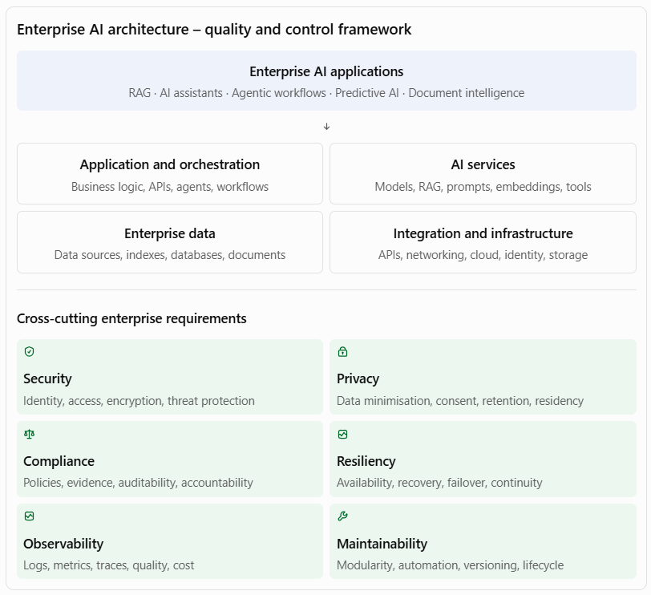

[Home](../../index.md) / [Expectation 5](index.md)

# 2. How the six enterprise requirements fit together

> Part of Expectation 5: Ensure AI solutions align with enterprise requirements for security, privacy, compliance, resiliency, observability, and maintainability

These requirements should not be implemented as six independent checklists. They need to work together as a common set of architecture controls.

The architectural objective is to establish a common control framework that can be applied to different AI applications without requiring each product team to reinvent security, privacy, resilience, or operational practices.

For example, a banking customer-service assistant and a banking loan-processing agent may use the same identity, model gateway, telemetry, and governance services, but have different data permissions, approval controls, availability targets, and compliance requirements.

## Page navigation

- Previous: [1. Expand the key responsibilities](responsibilities.md)
- Next: [3. Practical interview case study: Enterprise AI architecture for a bank](exercises.md)
- [Back to Expectation 5](index.md)
- [Main index](../../index.md)
