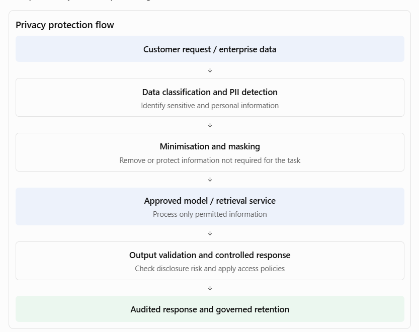
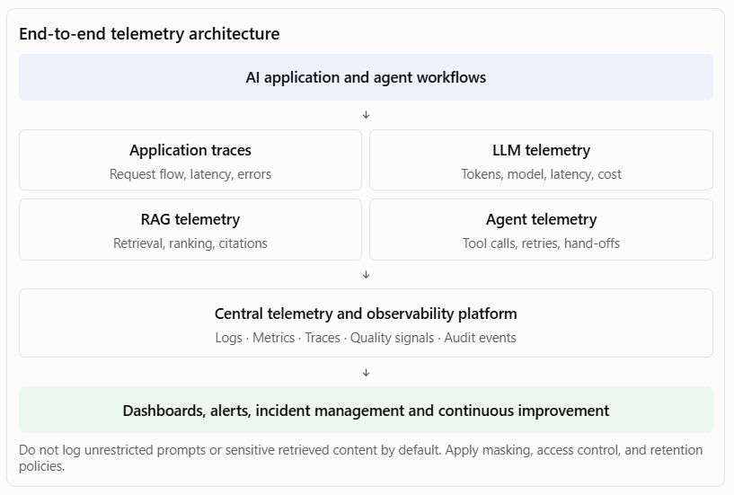

[Home](../../index.md) / [Expectation 5](index.md)

# 1. Expand the key responsibilities

> Part of Expectation 5: Ensure AI solutions align with enterprise requirements for security, privacy, compliance, resiliency, observability, and maintainability

### A. Ensure AI security

#### What this means

AI security extends beyond traditional application security. An AI solution introduces additional attack surfaces through prompts, retrieved documents, model interactions, agent tools, training or fine-tuning data, and generated outputs.

As Principal Architect, you must ensure that security is designed into every layer of the AI solution.

#### Key architectural responsibilities

#### 1. Identity and access management

- Integrate enterprise identity providers and single sign-on.
- Apply role-based access control (RBAC) and attribute-based access control (ABAC).
- Use least-privilege permissions for applications, agents, and tools.
- Enforce service-to-service authentication using managed identities or equivalent mechanisms.
- Ensure that an agent cannot inherit unrestricted access simply because its user has broad permissions.

#### 2. Data and information security

- Encrypt data at rest and in transit.
- Protect prompts, embeddings, retrieved documents, model inputs, and outputs.
- Apply data classification and handling policies.
- Mask or redact sensitive information where appropriate.
- Protect secrets, API keys, credentials, and model endpoints.

#### 3. LLM-specific security

- Protect against direct and indirect prompt injection.
- Prevent sensitive information disclosure.
- Validate model outputs before using them in downstream systems.
- Protect against insecure tool invocation and excessive agent autonomy.
- Defend against malicious documents and poisoned knowledge sources.

#### 4. API and integration security

- Secure enterprise APIs using OAuth 2.0, managed identities, or equivalent mechanisms.
- Apply API gateways, rate limiting, schema validation, and request controls.
- Validate tool arguments before execution.
- Separate read operations from high-impact write operations.
- Apply approval controls to sensitive transactions.

#### 5. AI supply-chain security

- Assess foundation models, third-party libraries, plugins, and orchestration frameworks.
- Validate model provenance and deployment configurations.
- Scan containers and dependencies.
- Control model and package versions.
- Maintain approved technology inventories.

Industry examples

| **Industry** | **Security concern** | **Architectural control** |
| --- | --- | --- |
| Banking | Customer data exposed through a RAG assistant | Document-level authorisation, identity propagation, encryption |
| Insurance | Agent accesses claims beyond its assigned portfolio | Claims-level permissions and scoped agent tools |
| Healthcare | Patient records disclosed to unauthorised users | Patient-context access checks, masking, audit logging |
| Telecommunications | AI agent invokes unauthorised network operations | Tool allowlists, least privilege, approval for sensitive changes |
| Government | Confidential citizen information exposed through an AI assistant | Data classification, restricted retrieval, identity-based access |

#### Example: Securing an enterprise RAG application

Suppose a bank has an AI assistant that retrieves information from customer documents, loan policies, and internal operational manuals.

A critical security requirement is that the assistant must not retrieve documents merely because they exist in the vector database.

The architecture must enforce:

- User authentication before retrieval.
- User and group permissions propagated into the retrieval layer.
- Document-level access filtering before content is provided to the LLM.
- Metadata-based filtering for business unit, customer, and document classification.
- Output checks to reduce the risk of sensitive information disclosure.
- Audit records of the user, retrieved sources, model invocation, and response.

Principal Architect perspective: I would treat the LLM as an untrusted reasoning component operating within a controlled enterprise security boundary. Authorisation decisions and business permissions must be enforced by trusted application and data services, not delegated to the model.

### B. Ensure AI privacy

#### What this means

Privacy focuses on how personal and sensitive information is collected, processed, stored, retrieved, shared, and deleted throughout the AI lifecycle.

An important architectural concern is that sensitive data can appear in places that traditional applications may not normally expose, such as prompts, embeddings, conversation history, model logs, evaluation datasets, and third-party model requests.

#### Key architectural responsibilities

#### 1. Data minimisation

- Send only the information necessary for the AI task.
- Avoid including entire customer records when selected attributes are sufficient.
- Remove unnecessary personal identifiers before model processing.

#### 2. Consent and lawful processing

- Identify the purpose for which personal data is processed.
- Ensure appropriate legal basis and consent where required.
- Respect purpose limitations and data-subject rights.

#### 3. Sensitive data protection

- Detect and classify personally identifiable information (PII).
- Mask, redact, or tokenise sensitive fields.
- Protect financial, health, identity, and confidential business information.

#### 4. Data residency and third-party processing

- Understand where data is processed and stored.
- Assess third-party model-provider data handling.
- Verify contractual commitments concerning retention, training use, and subprocessors.
- Apply regional processing requirements where applicable.

#### 5. Retention and deletion

- Define retention periods for prompts, responses, conversation histories, and logs.
- Support deletion and correction workflows where applicable.
- Understand how deletion requirements apply to derived data such as embeddings and cached content.

#### 6. Privacy impact assessments

- Conduct privacy impact assessments for sensitive use cases.
- Identify risks before production deployment.
- Document mitigations and residual risks.

Industry examples

| **Industry** | **Privacy scenario** | **Architectural approach** |
| --- | --- | --- |
| Banking | Customer asks questions about financial accounts | Restrict model context to authorised account data and minimise personal information |
| Insurance | Claims assistant processes medical reports | Redact unnecessary medical identifiers and restrict access |
| Healthcare | Clinical assistant summarises patient records | Apply patient-context permissions, purpose restrictions, and controlled retention |
| Telecommunications | Customer-support agent accesses call and usage data | Limit access to required customer attributes and apply retention controls |
| Government | Citizen assistant processes identity and benefit applications | Apply purpose limitation, data minimisation, and regional data-handling controls |

#### Example: Privacy-aware AI processing

Principal Architect perspective: I would ensure privacy controls are implemented in the data pipeline, retrieval layer, model gateway, application, and observability platform. Privacy should not depend on users remembering to avoid entering sensitive information into prompts.

### C. Ensure regulatory and enterprise compliance

#### What this means

Compliance means ensuring that AI solutions operate within applicable laws, regulations, contractual obligations, industry standards, and internal enterprise policies.

The important distinction is that compliance cannot be achieved simply by adding a disclaimer to an AI-generated response. It must be supported by architecture controls, documented processes, evidence, accountability, and ongoing monitoring.

A Principal Architect should translate regulatory and enterprise obligations into technical requirements and ensure that those requirements are implemented consistently.

#### Key architectural responsibilities

#### 1. Regulatory and policy mapping

- Identify the regulations and standards applicable to the business, geography, data, and use case.
- Map regulatory obligations to architecture controls.
- Maintain a traceability matrix connecting requirements, controls, evidence, and owners.
- Involve legal, compliance, risk, and security teams in interpreting obligations.

#### 2. AI risk classification

- Classify AI use cases according to their potential impact.
- Apply stronger controls to high-impact or regulated use cases.
- Define approval requirements before production deployment.
- Reassess risk when the model, data, purpose, or degree of autonomy changes.

#### 3. Auditability and explainability

- Record model and prompt versions.
- Maintain traceability of retrieved evidence and tool calls.
- Capture human approvals, overrides, and exception decisions.
- Provide sufficient evidence to reconstruct how an outcome was produced.
- Distinguish between an explanation of the system's process and proof that a model's internal reasoning is correct.

#### 4. Records and evidence management

- Maintain AI system inventories and risk assessments.
- Preserve test results, approvals, model documentation, and change records.
- Define retention and deletion policies.
- Ensure audit records are protected from unauthorised modification.

#### 5. Third-party and vendor compliance

- Assess model providers, cloud services, data processors, and external AI tools.
- Review data processing agreements and contractual restrictions.
- Understand model-provider retention, training, residency, and subprocessor arrangements.
- Establish ongoing supplier risk reviews.

#### 6. Compliance lifecycle management

- Include compliance checkpoints in architecture reviews and release pipelines.
- Revalidate compliance after material model or workflow changes.
- Monitor control effectiveness in production.
- Manage policy exceptions through formal risk acceptance and remediation.

Industry examples

| **Industry** | **Compliance requirement** | **Architectural control** |
| --- | --- | --- |
| Banking | Financial regulations, model risk, auditability, fair lending | Model inventory, approval evidence, decision traceability |
| Insurance | Claims and underwriting obligations, customer fairness | Documented decision controls, human review, audit records |
| Healthcare | Patient privacy, clinical safety, health-data obligations | Clinical oversight, access controls, consent and retention policies |
| Telecommunications | Customer privacy, data protection, sector obligations | Purpose-based data access, consent and audit trails |
| Government | Public-sector accountability, transparency, records obligations | Traceable eligibility processes, documented rules and appeal mechanisms |

#### Example: Compliance architecture for AI-supported loan underwriting

Assume a bank uses AI to extract information from financial documents and generate a recommendation for a loan officer.

The architecture should provide:

- A registered AI use case with an identified business owner.
- A documented risk classification and approved purpose.
- Approved models and version-controlled prompts.
- Controlled access to customer and credit information.
- Traceable source documents and extracted fields.
- A separate, governed credit-policy and decision service.
- Human approval where required by the bank's policy.
- An audit record of evidence, recommendation, approval, and final outcome.
- Periodic monitoring for accuracy, fairness, and policy compliance.

The key principle is that the model's recommendation must not silently become an unaudited credit decision.

Principal Architect perspective: I would establish a compliance-by-design approach in which every regulatory obligation is translated into a control, assigned an owner, tested, and supported by evidence. The exact requirements would be determined by the jurisdiction and the regulated activity rather than assuming one universal compliance checklist.

### D. Design for resiliency and high availability

#### What this means

AI applications depend on multiple components: model providers, retrieval services, vector databases, orchestration engines, APIs, data stores, and enterprise systems. Failure of any one component can affect the entire AI workflow.

A Principal Architect must design AI systems to tolerate component failures, recover from interruptions, manage variable demand, and preserve business continuity.

Resiliency is particularly important for agentic systems because one user request may trigger several dependent operations.

#### Key architectural responsibilities

#### 1. Availability architecture

- Define availability targets based on business criticality.
- Eliminate single points of failure in critical components.
- Use appropriate redundancy and multi-zone deployment.
- Define regional recovery strategies where justified.
- Design graceful degradation when optional AI capabilities are unavailable.

#### 2. Model-provider resilience

- Support approved model fallback strategies.
- Use circuit breakers and bounded retries.
- Handle provider throttling and rate limits.
- Apply request timeouts and concurrency controls.
- Avoid uncontrolled fallback to a model with different privacy or security characteristics.

#### 3. Workflow and agent resilience

- Persist workflow and agent state.
- Support resumable execution for long-running processes.
- Use idempotency keys to prevent duplicate business actions.
- Apply retry policies with backoff and dead-letter handling.
- Escalate unrecoverable failures to human operators.

#### 4. Data resilience

- Back up critical data and configuration.
- Protect vector indexes and source-document metadata.
- Version prompts, evaluation datasets, and model configurations.
- Test recovery of the complete AI application, not just its database.

#### 5. Capacity and performance resilience

- Test peak concurrent requests and token throughput.
- Manage queues and backpressure.
- Set token, context, and request limits.
- Scale retrieval and inference components appropriately.
- Protect the service against uncontrolled consumption.

#### 6. Business continuity and disaster recovery

- Define Recovery Time Objectives (RTO) and Recovery Point Objectives (RPO).
- Identify critical business workflows and their acceptable downtime.
- Maintain documented recovery procedures.
- Test failover and restoration scenarios.
- Define manual or non-AI fallback processes for critical business operations.

Industry examples

| **Industry** | **Resilience scenario** | **Architectural approach** |
| --- | --- | --- |
| Banking | Loan-processing model provider becomes unavailable | Approved fallback, durable workflow state, manual processing route |
| Insurance | Claims surge after a natural disaster | Queue-based processing, autoscaling, prioritisation and retry handling |
| Healthcare | Clinical assistant retrieval service fails | Graceful degradation, approved alternative workflow, clinical fallback |
| Telecommunications | AI network operations platform receives an event spike | Event buffering, backpressure, workload prioritisation |
| Government | Citizen-service AI experiences a regional outage | Regional recovery, cached approved information where appropriate, alternative service channel |

#### Example: Resilient AI loan-processing workflow

Consider a loan-processing agent that performs document extraction, credit checks, policy validation, and recommendation generation.

Potential failure scenarios and controls:

| **Failure scenario** | **Required control** |
| --- | --- |
| LLM provider unavailable | Approved fallback model or manual processing |
| Vector database unavailable | Retry, recover service, or use approved alternative knowledge access |
| Credit API times out | Bounded retries and workflow suspension |
| Agent crashes midway | Persisted workflow state and resumable execution |
| Duplicate payment or transaction request | Idempotency and transaction validation |
| Model returns malformed output | Schema validation and controlled exception handling |
| Approval service unavailable | Persist pending approval; do not bypass the control |

Principal Architect perspective: I would design for failure rather than assume that every AI dependency will remain available. I would define recovery objectives, identify critical dependencies, introduce fallback patterns, and regularly test failure scenarios through resilience and disaster-recovery exercises.

### E. Establish end-to-end AI observability

#### What this means

Observability provides the ability to understand the internal behaviour and operational health of an AI solution from its outputs and execution telemetry.

Traditional application monitoring is not sufficient. An AI application may be technically available but still produce poor answers, retrieve irrelevant documents, repeatedly invoke tools, or generate excessive costs.

The architecture must provide visibility into both conventional system health and AI-specific behaviour.

#### Key architectural responsibilities

#### 1. Distributed tracing

- Trace a request across applications, orchestration, model calls, retrieval, and enterprise APIs.
- Use correlation IDs and trace context.
- Identify slow or failing components.
- Reconstruct multi-step agent execution paths.

#### 2. Model and inference monitoring

- Track model availability and error rates.
- Monitor response latency and throughput.
- Track token consumption and cost.
- Monitor model version and deployment changes.

#### 3. RAG observability

- Track retrieved document identifiers and metadata.
- Measure retrieval quality and ranking behaviour.
- Monitor citation coverage and source freshness.
- Detect access-control filtering failures.

#### 4. Agent observability

- Record tool invocation, input validation, and execution outcome.
- Monitor retries, loops, hand-offs, and escalation.
- Identify excessive or unnecessary tool usage.
- Track task completion and human intervention.

#### 5. Quality and safety monitoring

- Monitor groundedness and answer relevance.
- Track output-policy violations.
- Monitor user feedback and correction rates.
- Detect quality degradation after model or prompt changes.

#### 6. Operational monitoring

- Monitor availability, queue depth, error rate, and service latency.
- Define service-level indicators and objectives.
- Create alerts for service degradation and abnormal consumption.
- Integrate with enterprise incident-management processes.

Industry examples

| **Industry** | **Observability requirement** | **Example operational measure** |
| --- | --- | --- |
| Banking | Trace loan-agent execution and evidence | Successful workflow rate, exception rate, audit completeness |
| Insurance | Monitor claims extraction and assessment | Extraction accuracy, rework rate, processing time |
| Healthcare | Monitor clinical assistant quality and escalation | Source coverage, clinician override rate |
| Telecommunications | Monitor network-agent tool execution | Remediation success, failed tool calls, incident resolution time |
| Government | Trace citizen-service responses and application processing | Response quality, escalation rate, service availability |

#### Example: AI observability architecture

A particularly important point for interviews: observability and auditability overlap, but they are not identical. Observability supports operational diagnosis; auditability provides controlled evidence of activities, decisions, and approvals.

Principal Architect perspective: I would define common telemetry standards and integrate AI observability into enterprise monitoring and incident-management platforms. Every production AI solution should provide sufficient visibility to diagnose failures, assess quality, understand cost, and demonstrate operational accountability.

### F. Ensure maintainability and evolvability

#### What this means

AI solutions must be designed so that they can be modified, tested, upgraded, scaled, and operated over time without introducing unacceptable risk.

AI technology evolves rapidly. Models change, APIs are deprecated, prompts require refinement, retrieval strategies improve, and new security vulnerabilities emerge. Maintainability therefore requires architectural separation, version control, automation, documentation, and disciplined change management.

#### Key architectural responsibilities

#### 1. Modular architecture

- Separate business logic, orchestration, model access, retrieval, and integration layers.
- Avoid hard-coding provider-specific model behaviour into business applications.
- Use well-defined interfaces and contracts.
- Keep deterministic business rules outside prompts wherever possible.

#### 2. Model and provider independence

- Use a model gateway or abstraction layer where justified.
- Avoid unnecessary dependency on proprietary APIs.
- Maintain model configuration and capability metadata.
- Support controlled provider and model migration.
- Test behavioural differences before switching models.

#### 3. Version management

- Version prompts, models, embeddings, indexes, tools, and orchestration workflows.
- Maintain deployment and rollback capability.
- Track changes to source data and retrieval configurations.
- Record evaluation results against each release.

#### 4. Automated testing and CI/CD

- Introduce automated unit, integration, security, and regression testing.
- Test retrieval quality and model outputs.
- Validate agent tool contracts and workflow behaviour.
- Apply release gates based on evaluation and security results.
- Use controlled rollout, canary deployments, and rollback.

#### 5. Documentation and architecture governance

- Maintain architecture decision records (ADRs).
- Document APIs, model dependencies, prompts, and data flows.
- Maintain operational runbooks.
- Define ownership for every production AI component.
- Review architecture when significant dependencies change.

#### 6. Technical debt and lifecycle management

- Monitor deprecated models, libraries, and APIs.
- Review prompt complexity and orchestration sprawl.
- Remove obsolete components and unused AI services.
- Reassess cost and performance as usage grows.
- Plan model migration and platform upgrades.

Industry examples

| **Industry** | **Maintainability challenge** | **Architectural approach** |
| --- | --- | --- |
| Banking | Model provider changes its API or model version | Model abstraction, regression evaluation, controlled migration |
| Insurance | Claims extraction rules change frequently | Modular extraction services, versioned schemas and test datasets |
| Healthcare | Clinical knowledge sources and guidelines evolve | Versioned knowledge ingestion and source provenance |
| Telecommunications | New network APIs and orchestration patterns are introduced | API contracts, reusable tool adapters, automated integration tests |
| Government | Policy and eligibility rules change | Separate policy services, version-controlled rules and auditable releases |

#### Example: Maintainable enterprise AI architecture

Consider a customer-service AI application.

A poorly designed solution might combine prompt instructions, business rules, API credentials, model-specific code, and customer-service workflow logic in one application.

A maintainable design separates these concerns:

- Application layer: Customer experience and channel integration.
- Business/domain layer: Customer-service policies and business capabilities.
- Orchestration layer: Coordinates agents, workflow steps, and approvals.
- AI service layer: Model gateway, prompt management, retrieval, and evaluation.
- Integration layer: CRM, billing, order management, and enterprise APIs.
- Infrastructure layer: Hosting, networking, secrets, monitoring, and scaling.

This separation allows the organisation to change the model provider without rewriting business logic, update the customer-service workflow without modifying the model gateway, or replace the retrieval technology without changing the user interface.

Principal Architect perspective: I would design AI applications around modular capabilities and stable contracts, with version-controlled artefacts, automated quality gates, and clear component ownership. The goal is to reduce vendor lock-in, limit change impact, and make AI systems safe to evolve.

## Page navigation

- Next: [2. How the six enterprise requirements fit together](architecture.md)
- [Back to Expectation 5](index.md)
- [Main index](../../index.md)
