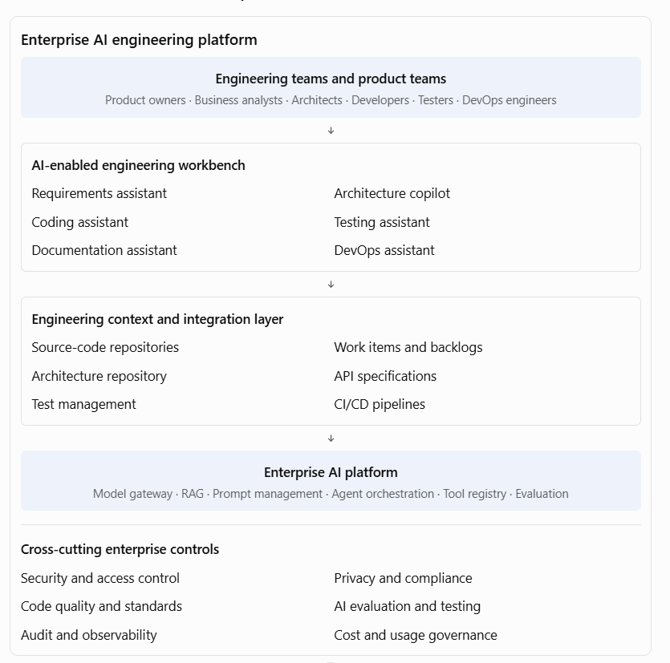

[Home](../../index.md) / [Expectation 6](index.md)

# 3. How to architect an enterprise AI-powered PDLC

> Part of Expectation 6: Help engineering teams leverage AI-powered PDLC capabilities across coding, testing, documentation, analysis, and delivery workflows

The Principal Architect should not approach this as a collection of independent developer tools. The objective is to establish an integrated AI engineering platform that connects requirements, architecture, code, tests, documentation, and delivery artefacts.

#### Important architectural components

| **Component** | **Responsibility** |
| --- | --- |
| AI engineering workbench | Provides a consistent experience for engineering roles |
| Model gateway | Provides controlled access to approved models |
| Engineering knowledge RAG | Retrieves relevant code, architecture standards, APIs, and documentation |
| Agent orchestration | Coordinates multi-step engineering tasks |
| Tool registry | Exposes approved repository, build, test, and deployment operations |
| Evaluation framework | Evaluates generated code, tests, documentation, and agent outcomes |
| Engineering integration layer | Connects work-item management, source control, CI/CD, and test systems |
| Governance and telemetry | Controls access, captures activity, and measures performance |

#### The importance of engineering context

An AI coding assistant without sufficient context may generate technically valid code that does not comply with the organisation's architecture.

For example, a developer asks an AI assistant to create a new customer API. The assistant should ideally have access to approved information about:

- Enterprise API standards.
- Existing customer-service APIs.
- Authentication and authorisation patterns.
- Naming conventions.
- Domain models.
- Error-handling standards.
- Logging and monitoring standards.
- Approved technology stacks.

This is where enterprise RAG, repository context, reusable agent instructions, and tool integrations become important.

The objective is to make AI recommendations consistent with the organisation's engineering practices rather than relying on generic model knowledge.

## 4. Introduce an AI-assisted engineering workflow

One particularly useful approach is spec-driven development.

Instead of asking an AI coding assistant to generate an application directly from a loosely defined business request, first create a validated specification. The specification becomes the basis for design, coding, testing, and validation.

#### AI-assisted spec-driven engineering

1. Define intent

Product owner provides the business objective and requirements.

1. Specify

AI helps produce user stories, acceptance criteria, and business rules.

1. Clarify

AI identifies ambiguities, dependencies, assumptions, and edge cases.

1. Plan

Architect and engineering team approve the solution design, constraints, and implementation approach.

1. Create tasks

AI helps decompose the approved design into implementation tasks.

1. Implement

Coding assistants and agents help generate code, tests, and documentation.

1. Validate

Automated tests, security checks, code review, and human approval validate the implementation against the specification.

This approach is particularly useful because it creates a traceable connection between business intent and implementation. Microsoft's GitHub Spec Kit describes a similar specification-first workflow.

Microsoft for Developers

#### Example: Implementing a customer onboarding feature

| **PDLC stage** | **AI-assisted activity** | **Engineering artefact** |
| --- | --- | --- |
| Requirements | Analyse onboarding requirements | User stories and acceptance criteria |
| Analysis | Identify impacted systems | Dependency and impact report |
| Architecture | Generate design alternatives | Component and sequence diagrams |
| Development | Generate API and service code | Source code and configuration |
| Testing | Generate test scenarios | Unit and integration tests |
| Documentation | Generate API and technical documentation | OpenAPI specification and design notes |
| Delivery | Analyse release changes | Release notes and deployment checklist |
| Operations | Analyse logs and incidents | Incident summary and remediation suggestions |

A key control is that the artefacts must pass through appropriate engineering reviews. AI-generated specifications are not automatically approved requirements, and AI-generated code is not automatically production-ready software.

## 5. Governance model for AI-powered engineering

At enterprise scale, engineering teams need freedom to use AI productively, but within common guardrails.

I would establish the following governance model.

| **Governance area** | **Enterprise standard** |
| --- | --- |
| Approved AI tools | Maintain an approved catalogue of coding assistants, models, and agents |
| Source-code protection | Define which repositories and code classifications may be shared with AI services |
| Developer identity | Ensure AI tools operate under authenticated user or approved service identities |
| Agent permissions | Apply least privilege and restrict write, merge, and deployment operations |
| Code quality | Require peer review, automated testing, and static analysis |
| Security | Scan generated code and dependencies; protect secrets and credentials |
| Architecture | Validate generated solutions against enterprise standards |
| IP and licensing | Apply policies for provenance, third-party code, and licence compliance |
| Auditability | Record relevant AI-assisted changes and agent actions |
| Human accountability | Keep developers and designated approvers accountable for changes |

An important design distinction:

AI assistants and AI agents should not necessarily have the same permissions.

- An assistant may suggest code to a developer.
- A coding agent may create a branch and submit a pull request.
- A deployment agent may prepare a release but require approval before production deployment.
- A production operations agent may execute a narrowly defined, reversible action under an approved policy.

Permissions should be based on the task, environment, business risk, and identity—not simply on the capabilities of the AI tool.

NIST's DevSecOps reference model discusses controlled AI integration across software development, security, deployment, and operations, including human oversight and verification of AI-generated outputs.

NIST Pages+2

## Page navigation

- Previous: [2. Expand the key responsibilities](responsibilities.md)
- Next: [6. Practical enterprise case study: AI-powered PDLC transformation](exercises.md)
- [Back to Expectation 6](index.md)
- [Main index](../../index.md)
