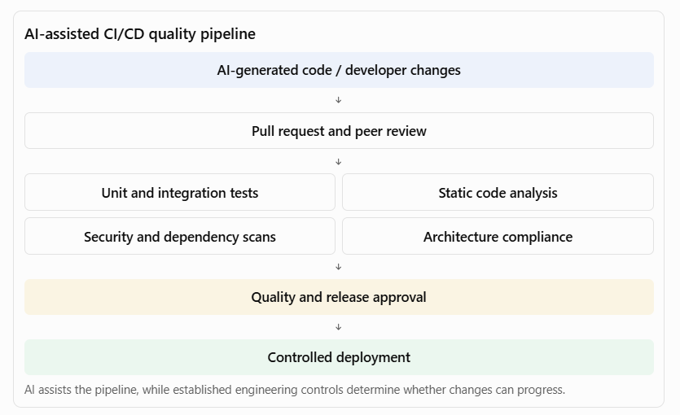

[Home](../../index.md) / [Expectation 6](index.md)

# 6. Practical enterprise case study: AI-powered PDLC transformation

> Part of Expectation 6: Help engineering teams leverage AI-powered PDLC capabilities across coding, testing, documentation, analysis, and delivery workflows

Assume a large bank has 20 engineering teams developing and maintaining digital banking, loan processing, payments, and customer-service applications.

The organisation wants to improve engineering productivity and reduce delivery timelines through AI adoption.

As Principal Architect, I would propose a phased transformation.

#### Phase 1 — Assess the current engineering lifecycle

Assess the current development process across:

- Requirements gathering and analysis.
- Architecture and design.
- Development and code reviews.
- Testing and defect management.
- Documentation.
- CI/CD and release management.
- Production support.

Identify bottlenecks such as:

- Excessive manual documentation.
- Repetitive code development.
- Slow test-case creation.
- Long code-review cycles.
- Poor understanding of legacy applications.
- Manual impact analysis.
- Repeated production incidents.

#### Phase 2 — Establish the AI engineering platform

Introduce a standard platform with:

- Enterprise-approved AI coding assistants.
- AI-powered engineering knowledge assistant.
- AI architecture and requirements assistant.
- AI testing and code-review capabilities.
- AI-powered documentation generation.
- AI-assisted DevOps and incident analysis.
- Centralised AI governance and usage monitoring.

#### Phase 3 — Run controlled pilots

Start with three use cases.

| **Pilot** | **Scope** | **Expected benefit** |
| --- | --- | --- |
| AI coding assistant | Code generation, debugging, refactoring | Reduced repetitive development effort |
| AI testing assistant | Test-case generation and unit-test scaffolding | Faster test preparation and improved coverage |
| Engineering knowledge assistant | Search architecture, APIs, and code documentation | Reduced onboarding and investigation time |

Establish baseline measurements before the pilots.

#### Phase 4 — Integrate AI into engineering workflows

Integrate AI capabilities with:

- Work-item and backlog management.
- Git repositories.
- IDEs.
- Pull-request workflows.
- Automated testing.
- CI/CD pipelines.
- Monitoring and incident-management systems.

The aim is to avoid isolated AI tools that require developers to constantly switch between applications and manually transfer information.

#### Phase 5 — Establish engineering quality gates

AI-generated code and engineering artefacts must pass the same enterprise controls as manually generated work.

A sample pipeline:

#### Phase 6 — Scale adoption across engineering teams

Once pilots demonstrate measurable improvements:

- Establish reusable AI engineering patterns.
- Create shared prompts, instructions, and agent templates.
- Introduce AI engineering champions.
- Provide training for developers, architects, testers, and DevOps engineers.
- Establish platform onboarding standards.
- Monitor adoption and engineering outcomes.
- Continuously improve based on feedback.

## Page navigation

- Previous: [3. How to architect an enterprise AI-powered PDLC](architecture.md)
- Next: [7. Metrics to measure AI-powered PDLC success](preparation.md)
- [Back to Expectation 6](index.md)
- [Main index](../../index.md)
