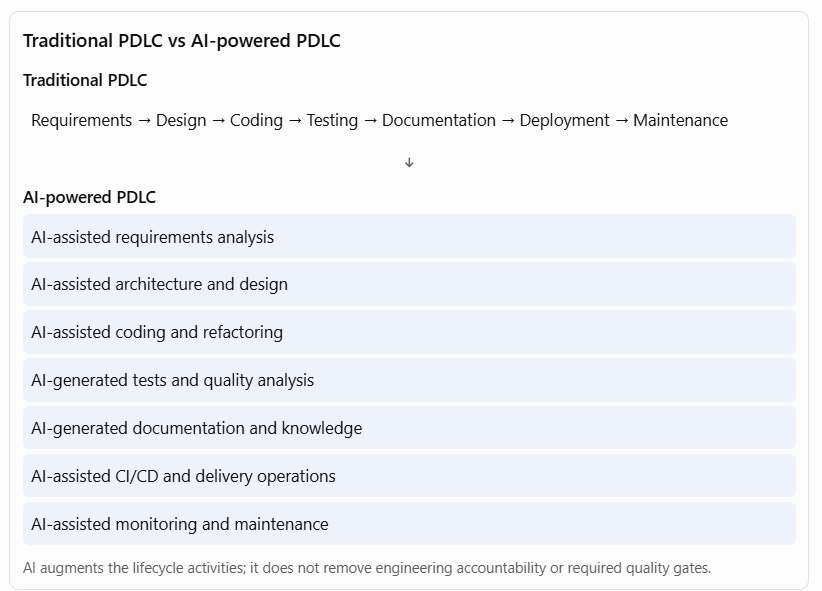

[Home](../../index.md)

# Expectation 6: Help engineering teams leverage AI-powered PDLC capabilities across coding, testing, documentation, analysis, and delivery workflows

This expectation is about transforming the traditional Product Development Life Cycle (PDLC) into an AI-enabled engineering lifecycle. A Principal Architect is expected to help engineering teams use AI to improve productivity, software quality, delivery speed, engineering consistency, and operational effectiveness across the entire development lifecycle—not just introduce coding assistants.

My approach would be to define an enterprise AI-powered engineering strategy that integrates AI capabilities into requirements analysis, solution design, coding, testing, documentation, code reviews, DevSecOps, deployment, and production support. I would establish reusable engineering patterns, approved AI tools, secure development practices, integration standards, and measurable productivity metrics. I would also ensure that AI-generated code and engineering artefacts remain subject to human review, automated quality gates, security validation, and architecture governance.

The objective is to make AI a practical engineering capability embedded in everyday workflows, while retaining developer accountability, software quality, architectural integrity, and enterprise security.

## 1. Understand AI-powered PDLC

Traditional PDLC follows a sequence of activities from business requirements through software development, testing, deployment, and maintenance.

AI-powered PDLC introduces AI assistants, agents, and automation into these activities to augment engineering teams.

The Principal Architect's responsibility is to determine where AI provides genuine value, which activities can be automated, which require human judgement, and how these capabilities can be adopted consistently across engineering teams.

## Pages in this expectation

- [2. Expand the key responsibilities](responsibilities.md) - Requirements, design, coding, testing, documentation, analysis, and delivery workflows.
- [3. How to architect an enterprise AI-powered PDLC](architecture.md) - Architecture components, engineering context, AI-assisted workflow, and governance model.
- [6. Practical enterprise case study: AI-powered PDLC transformation](exercises.md) - A six-phase enterprise PDLC transformation case study.
- [7. Metrics to measure AI-powered PDLC success](preparation.md) - Metrics, resources, interview questions, and a 10-day preparation plan.
- [11. Your interview-ready closing statement](positioning.md) - Closing statement and how to position Appian and application architecture experience.

## Navigate

- Previous: [Expectation 5: Ensure AI solutions align with enterprise requirements for security, privacy, compliance, resiliency, observability, and maintainability](../05-enterprise-requirements-security-privacy-compliance/index.md)
- Next: [Expectation 7: Guide architecture decisions across application, data, integration, platform, and operational concerns to avoid fragmented or duplicative solutions](../07-architecture-decisions/index.md)
- [Main index](../../index.md)
