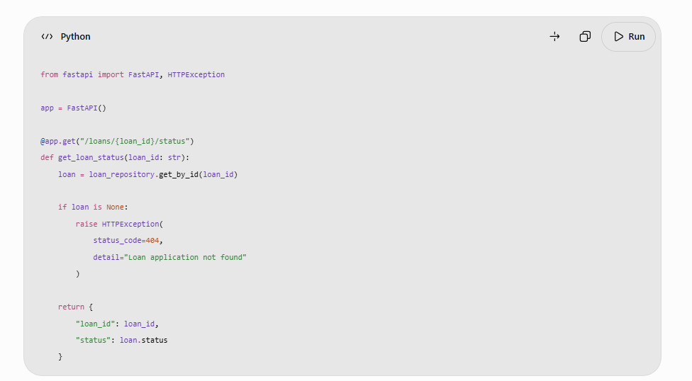

[Home](../../index.md) / [Expectation 6](index.md)

# 2. Expand the key responsibilities

> Part of Expectation 6: Help engineering teams leverage AI-powered PDLC capabilities across coding, testing, documentation, analysis, and delivery workflows

### A. Enable AI-powered requirements analysis and business analysis

#### What this means

AI can help engineering and product teams convert business requirements into structured, traceable, implementation-ready engineering artefacts.

Traditionally, business analysts and product owners manually analyse requirements, identify gaps, create user stories, define acceptance criteria, and prepare functional specifications.

AI can accelerate these activities by analysing documents, meeting transcripts, business processes, existing application behaviour, and historical requirements.

#### Key architectural responsibilities

1. Requirements interpretation
  - Analyse business requirement documents.
  - Summarise stakeholder discussions and workshops.
  - Identify ambiguous, conflicting, or incomplete requirements.
  - Extract business rules and functional requirements.
  - Identify dependencies and assumptions.
1. User story generation
  - Convert requirements into epics and user stories.
  - Generate acceptance criteria.
  - Identify functional and non-functional requirements.
  - Suggest edge cases and exception scenarios.
  - Map stories to business capabilities.
1. Impact analysis
  - Analyse existing application components.
  - Identify impacted APIs, databases, services, and workflows.
  - Identify upstream and downstream dependencies.
  - Assess potential changes to existing business processes.
  - Generate initial impact assessments for engineering review.
1. Requirements traceability
  - Link business requirements to user stories.
  - Link stories to design components and implementation artefacts.
  - Link requirements to test cases.
  - Identify requirements without corresponding test coverage.
  - Highlight changes that may affect existing functionality.

Industry examples

| **Industry** | **AI-assisted analysis** | **Example output** |
| --- | --- | --- |
| Banking | Analyse loan-processing requirements | User stories, credit-check rules, exception scenarios |
| Insurance | Analyse claims-processing requirements | Claims workflow, document requirements, validation rules |
| Healthcare | Analyse patient-registration requirements | Patient journeys, data requirements, acceptance criteria |
| Telecommunications | Analyse service-provisioning requirements | Network dependencies, activation workflows, failure cases |
| Government | Analyse citizen-service requirements | Eligibility requirements, application journeys, policy constraints |

#### Example: Banking loan application

Suppose a product owner provides the following requirement:

"Customers should be able to apply for a personal loan online, upload supporting documents, and receive an eligibility decision."

An AI-assisted requirements analysis capability could generate:

- Epic: Digital Personal Loan Application.
- User story: As a customer, I want to submit a loan application online.
- Acceptance criteria:
  - Customer identity must be verified.
  - Mandatory documents must be submitted.
  - Income information must be validated.
  - Credit checks must be performed through an authorised service.
  - Incomplete applications must be routed for additional information.
- Exception scenarios:
  - Missing documentation.
  - Invalid identity information.
  - Credit API unavailable.
  - Customer fails eligibility rules.
- NFRs:
  - Secure customer authentication.
  - Data encryption.
  - Auditability.
  - Response-time requirements.
  - Accessibility.

The product owner and business analyst must validate these outputs before they become approved requirements.

Principal Architect perspective: I would encourage the use of AI to accelerate requirement decomposition, impact analysis, and traceability, while ensuring that business owners remain accountable for requirements and acceptance criteria.

### B. Enable AI-assisted architecture and solution design

#### What this means

AI can assist architects and engineers in exploring solution alternatives, analysing existing architectures, generating design artefacts, and identifying potential design risks.

However, architecture decisions involving security, scalability, integration, resilience, and technology standards must remain subject to qualified architectural judgement.

#### Key architectural responsibilities

1. Architecture discovery
  - Analyse existing application architecture documents.
  - Understand legacy systems, APIs, databases, and integrations.
  - Identify application dependencies and technology constraints.
  - Summarise architecture decision records.
  - Discover reusable enterprise components.
1. Solution design assistance
  - Generate initial component diagrams.
  - Propose service boundaries and API contracts.
  - Suggest integration patterns.
  - Generate sequence diagrams and data-flow diagrams.
  - Identify potential non-functional requirements.
1. Architecture alternatives
  - Compare synchronous and asynchronous integration.
  - Evaluate monolithic versus microservices designs.
  - Compare cloud deployment options.
  - Assess build-versus-buy alternatives.
  - Identify scalability and maintainability trade-offs.
1. Architecture governance
  - Check designs against enterprise reference architectures.
  - Identify deviations from technology standards.
  - Analyse security and compliance requirements.
  - Generate architecture review checklists.
  - Maintain architecture decision records.

Industry examples

| **Industry** | **AI-assisted architecture activity** | **Example** |
| --- | --- | --- |
| Banking | Loan-processing architecture | Generate service decomposition and integration options |
| Insurance | Claims automation architecture | Identify document intelligence and workflow components |
| Healthcare | Patient engagement platform | Analyse privacy, integration, and scalability requirements |
| Telecommunications | Network operations platform | Evaluate event-driven architecture and AI integration |
| Government | Digital citizen-services platform | Generate API and application integration designs |

#### Example: Architecture copilot

An engineering team provides an architecture document for an existing banking application.

The AI architecture assistant can:

1. Summarise the existing architecture.
1. Identify system dependencies.
1. Analyse API integration patterns.
1. Identify potential single points of failure.
1. Compare proposed modernisation options.
1. Generate an initial target-state architecture.
1. Prepare an architecture decision record for review.

The architect validates the recommendations and makes the final decisions.

Principal Architect perspective: I would introduce AI architecture assistants connected to approved enterprise architecture knowledge, technology standards, and reusable design patterns. This helps teams make consistent decisions and reduces the effort required for architecture discovery and documentation.

### C. Enable AI-powered software coding and development

#### What this means

AI-powered coding assists developers in writing, understanding, debugging, refactoring, and maintaining application code.

This is one of the most visible applications of AI in software engineering, but the Principal Architect's responsibility extends beyond providing developers with coding assistants. It includes establishing approved tools, integration patterns, secure coding practices, reusable prompts, coding standards, and governance mechanisms.

#### Key architectural responsibilities

1. Code generation
  - Generate code from approved requirements and design specifications.
  - Create API endpoints, service classes, data models, and integration components.
  - Generate boilerplate code and configuration.
  - Create database queries and data transformation logic.
  - Generate infrastructure-as-code templates.
1. Code understanding
  - Explain complex or unfamiliar code.
  - Summarise legacy application functionality.
  - Identify dependencies between modules.
  - Explain API behaviour and business logic.
  - Support developers onboarding to existing codebases.
1. Code refactoring
  - Identify duplicated code.
  - Suggest improvements to code structure.
  - Improve readability and modularity.
  - Identify opportunities to apply design patterns.
  - Support migration from legacy frameworks and languages.
1. Debugging assistance
  - Analyse stack traces and error messages.
  - Identify potential root causes.
  - Suggest code corrections.
  - Analyse application logs.
  - Recommend performance improvements.
1. Secure coding
  - Identify common security weaknesses.
  - Detect insecure coding patterns.
  - Suggest input validation and output encoding.
  - Identify hard-coded secrets and credentials.
  - Recommend remediation for vulnerabilities.
1. Developer productivity
  - Provide contextual code completion.
  - Generate unit-test scaffolding.
  - Assist with API client development.
  - Generate comments and code explanations.
  - Reduce repetitive development work.

Industry examples

| **Industry** | **AI-powered coding use case** | **Example** |
| --- | --- | --- |
| Banking | Digital banking development | Generate REST API implementations for customer and account services |
| Insurance | Claims application development | Generate document-processing and validation components |
| Healthcare | Patient management systems | Generate API integration and data transformation logic |
| Telecommunications | Network service applications | Generate event-processing and monitoring components |
| Government | Citizen-service applications | Generate form validation, application APIs, and workflow components |

#### Example: Building a loan-processing API

A developer receives an approved requirement to create an API that retrieves a loan application's status.

An AI coding assistant can help generate:

- FastAPI endpoint structure.
- Request and response schemas.
- Service-layer implementation.
- Database repository interface.
- Input validation.
- Error-handling logic.
- Unit-test scaffolding.
- API documentation.

For example, an initial endpoint might look like:

The generated implementation is only a starting point. Developers must validate the repository implementation, authentication and authorisation, error handling, logging, data exposure, and test coverage before merging it.

Principal Architect perspective: I would introduce approved AI coding assistants integrated with the engineering toolchain and enterprise coding standards. I would focus on increasing developer productivity without compromising clean architecture, code quality, security, and maintainability.

### D. Enable AI-powered software testing and quality engineering

#### What this means

AI can improve software testing by generating test cases, analysing requirements, identifying edge cases, creating test data, detecting defects, and helping engineering teams investigate failures.

The objective is to shift testing earlier in the development lifecycle and increase test coverage without relying entirely on manual test design.

#### Key architectural responsibilities

1. Test case generation
  - Generate test scenarios from user stories.
  - Create positive and negative test cases.
  - Identify boundary conditions.
  - Generate exception and failure scenarios.
  - Map test cases to acceptance criteria.
1. Unit testing
  - Generate unit-test scaffolding.
  - Suggest test inputs and expected outcomes.
  - Identify untested code paths.
  - Generate mocks and test fixtures.
  - Help improve branch and statement coverage.
1. Integration testing
  - Generate API integration test cases.
  - Identify dependency failures.
  - Test authentication and authorisation.
  - Validate message and event contracts.
  - Test database and external service interactions.
1. Regression testing
  - Analyse code changes and identify impacted components.
  - Recommend relevant regression tests.
  - Identify potential breaking changes.
  - Support automated regression suite optimisation.
  - Compare application behaviour across releases.
1. Performance and reliability testing
  - Generate workload scenarios.
  - Identify potential performance bottlenecks.
  - Analyse latency and throughput.
  - Help interpret load-test results.
  - Suggest capacity and scaling improvements.
1. AI-specific testing
  - Evaluate LLM output quality.
  - Test RAG retrieval and citation accuracy.
  - Test prompt-injection resistance.
  - Validate agent tool selection and execution.
  - Test hallucination, unsafe output, and guardrail behaviour.

Industry examples

| **Industry** | **AI-assisted testing** | **Example** |
| --- | --- | --- |
| Banking | Loan application testing | Generate eligibility, validation, and exception test cases |
| Insurance | Claims testing | Generate tests for missing documents, duplicate claims, and policy exceptions |
| Healthcare | Patient management testing | Test access controls, data validation, and patient record handling |
| Telecommunications | Network service testing | Generate tests for API failures, event processing, and network outages |
| Government | Citizen application testing | Test eligibility rules, missing documents, and application rejection scenarios |

#### Example: AI-generated testing for a loan application

Consider this user story:

"As a customer, I want to submit a loan application with supporting documents."

An AI testing assistant could generate the following scenarios:

| **Test scenario** | **Expected result** |
| --- | --- |
| Submit a valid application | Application successfully registered |
| Submit without mandatory documents | Application rejected or marked incomplete |
| Submit invalid income information | Validation error returned |
| Submit duplicate application | Duplicate detection applied |
| Credit API unavailable | Controlled retry or exception handling |
| Unauthorised customer accesses application | Access denied |
| Application exceeds allowed loan amount | Business validation triggered |

It can also generate initial automated test scripts, but the test team must validate the scenarios and expected results against approved business rules.

Principal Architect perspective: I would embed AI-assisted testing into the CI/CD pipeline, making automated test generation, security scanning, regression testing, and AI-specific evaluation part of the engineering quality gates.

### E. Enable AI-powered technical documentation and knowledge management

#### What this means

Software documentation is often incomplete, outdated, or disconnected from the actual implementation. AI can help engineering teams generate, update, search, and maintain technical documentation using approved source code, architecture artefacts, APIs, and engineering knowledge.

This is particularly valuable in organisations with large legacy application estates, multiple engineering teams, and distributed knowledge.

#### Key architectural responsibilities

1. Code documentation
  - Generate code comments and method descriptions.
  - Explain complex functions and classes.
  - Document configuration and dependencies.
  - Generate module-level documentation.
  - Identify missing or outdated documentation.
1. API documentation
  - Generate API descriptions and examples.
  - Explain request and response schemas.
  - Generate OpenAPI documentation.
  - Document error codes and integration behaviour.
  - Identify API contract changes.
1. Architecture documentation
  - Generate initial component descriptions.
  - Create sequence and data-flow diagrams.
  - Summarise architecture decisions.
  - Maintain system dependency documentation.
  - Generate technical design summaries.
1. Operational documentation
  - Generate deployment instructions.
  - Create operational runbooks.
  - Document common failure scenarios.
  - Generate incident troubleshooting guides.
  - Summarise recovery procedures.
1. Engineering knowledge assistants
  - Build RAG-based assistants over engineering documentation.
  - Enable developers to query architecture standards.
  - Retrieve API specifications and design decisions.
  - Search historical incident records.
  - Support onboarding of new developers.
1. Documentation lifecycle
  - Link documentation to source-code repositories.
  - Update documentation when implementation changes.
  - Maintain version history.
  - Assign documentation ownership.
  - Introduce review and approval workflows.

Industry examples

| **Industry** | **AI documentation use case** | **Example** |
| --- | --- | --- |
| Banking | Core banking documentation | Generate service descriptions, integration specifications, and operational runbooks |
| Insurance | Claims platform documentation | Document claims rules, APIs, and workflow configurations |
| Healthcare | Clinical application documentation | Generate interface and integration specifications |
| Telecommunications | Network management documentation | Document event flows, APIs, and operational procedures |
| Government | Public-service application documentation | Maintain service specifications, data flows, and audit documentation |

#### Example: Enterprise engineering knowledge assistant

An organisation has hundreds of applications, APIs, architecture documents, and operational runbooks.

A developer wants to understand how the customer onboarding application integrates with the identity verification service.

An AI knowledge assistant can:

1. Retrieve the relevant architecture documents.
1. Identify the application and integration components.
1. Retrieve the API specifications.
1. Explain the authentication mechanism.
1. Identify downstream dependencies.
1. Provide links to the original source documents.

The response should be grounded in approved documentation, respect access permissions, and identify when information is missing or outdated.

Principal Architect perspective: I would establish an enterprise engineering knowledge platform using governed retrieval and AI-assisted documentation. This would reduce dependency on individual knowledge holders, improve onboarding, and increase reuse of existing architecture assets.

### F. Enable AI-powered code analysis and engineering intelligence

#### What this means

AI can analyse source code, architecture repositories, test results, application logs, and development activity to identify risks and provide engineering insights.

This is broader than code generation. It helps architects and engineering leaders understand the health, complexity, dependencies, and maintainability of software estates.

#### Key architectural responsibilities

1. Static code analysis assistance
  - Identify code smells and design weaknesses.
  - Detect duplicated code and complexity.
  - Identify potential security vulnerabilities.
  - Highlight outdated dependencies.
  - Suggest refactoring opportunities.
1. Architecture analysis
  - Analyse dependencies across applications and services.
  - Identify tight coupling and circular dependencies.
  - Detect deviations from reference architecture.
  - Identify technology obsolescence.
  - Support modernisation assessments.
1. Change impact analysis
  - Analyse the impact of proposed code changes.
  - Identify dependent services and APIs.
  - Highlight affected test cases.
  - Assess database schema impact.
  - Generate change-risk summaries.
1. Defect analysis
  - Analyse logs and stack traces.
  - Correlate related production errors.
  - Identify probable root causes.
  - Summarise recurring defects.
  - Recommend corrective actions for engineering review.
1. Technical debt analysis
  - Identify obsolete libraries and frameworks.
  - Detect repeated workarounds and architectural anti-patterns.
  - Prioritise refactoring opportunities.
  - Estimate potential maintenance impact.
  - Track technical debt reduction.
1. Engineering intelligence
  - Analyse delivery bottlenecks.
  - Identify test failure patterns.
  - Monitor code-review turnaround.
  - Analyse build and deployment failures.
  - Provide team-level improvement insights without treating individual activity metrics as simplistic productivity scores.

Industry examples

| **Industry** | **AI-powered analysis** | **Example** |
| --- | --- | --- |
| Banking | Legacy banking modernisation | Identify dependencies and modernisation risks |
| Insurance | Claims application analysis | Detect duplicated business logic and workflow complexity |
| Healthcare | Patient platform analysis | Identify privacy and security weaknesses |
| Telecommunications | Network application analysis | Analyse service dependencies and failure patterns |
| Government | Legacy public-service systems | Identify obsolete technology and technical debt |

#### Example: Legacy application modernisation

Assume a bank wants to modernise an application developed using an older technology stack.

An AI-assisted engineering analysis solution can:

- Analyse source-code repositories.
- Identify application modules and dependencies.
- Identify database interactions.
- Detect duplicated business functionality.
- Identify obsolete libraries.
- Generate an initial application dependency map.
- Recommend potential modularisation options.
- Identify candidate services for modernisation.

The output should be treated as an initial assessment. Architects must validate dependencies, hidden business rules, performance characteristics, and migration risks before finalising the target architecture.

Principal Architect perspective: I would use AI-assisted engineering intelligence to make architecture and modernisation decisions more evidence-based. This can help engineering leaders prioritise technical debt, reduce change risk, and improve the long-term health of the application portfolio.

### G. Enable AI-powered delivery, DevOps, and release management

#### What this means

AI can support the delivery lifecycle by analysing build pipelines, identifying deployment risks, generating release documentation, investigating failures, and assisting production operations.

The goal is to improve delivery predictability and reduce the manual effort associated with software releases.

#### Key architectural responsibilities

1. CI/CD pipeline assistance
  - Generate pipeline configuration templates.
  - Analyse pipeline failures.
  - Recommend corrections for build errors.
  - Identify dependency and configuration issues.
  - Improve deployment automation.
1. Release management
  - Generate release notes from code and work-item changes.
  - Summarise features, fixes, and known issues.
  - Identify impacted applications.
  - Analyse release risks.
  - Prepare deployment checklists.
1. Deployment risk analysis
  - Analyse code changes and affected components.
  - Review test results and security findings.
  - Identify database migration risks.
  - Recommend deployment strategies.
  - Support canary and progressive rollout decisions.
1. Infrastructure automation
  - Generate infrastructure-as-code templates.
  - Explain cloud configuration.
  - Identify insecure infrastructure settings.
  - Suggest resource-sizing improvements.
  - Validate infrastructure configuration against standards.
1. Incident management
  - Summarise application incidents.
  - Correlate logs and monitoring alerts.
  - Suggest potential root causes.
  - Retrieve relevant operational runbooks.
  - Prepare incident reports and post-incident summaries.
1. Production support
  - Provide AI-assisted operational knowledge search.
  - Identify recurring failures.
  - Recommend remediation steps.
  - Automate low-risk operational actions under controlled permissions.
  - Escalate high-impact or uncertain actions to human operators.

Industry examples

| **Industry** | **AI-powered delivery use case** | **Example** |
| --- | --- | --- |
| Banking | Digital banking release management | Identify release dependencies and deployment risks |
| Insurance | Claims platform DevOps | Analyse failed deployments and generate release summaries |
| Healthcare | Clinical application delivery | Check release artefacts against security and validation requirements |
| Telecommunications | Network service delivery | Analyse pipeline failures and deployment telemetry |
| Government | Citizen-service releases | Generate compliance evidence and release documentation |

#### Example: AI-assisted production incident management

A banking application experiences a sudden increase in loan application failures.

An AI operations assistant can:

1. Retrieve relevant monitoring alerts.
1. Correlate application logs and traces.
1. Identify the affected service.
1. Analyse recent deployments.
1. Retrieve the relevant runbook.
1. Suggest possible root causes.
1. Prepare an incident summary.
1. Recommend remediation for operator approval.

For critical systems, the assistant should not independently execute high-impact remediation unless explicitly authorised under a tested and governed operational policy.

Principal Architect perspective: I would introduce AI into delivery and operations through controlled engineering workflows, integrating it with CI/CD, observability, incident management, and release governance. The focus would be faster and more predictable delivery, not uncontrolled automation.

## Page navigation

- Next: [3. How to architect an enterprise AI-powered PDLC](architecture.md)
- [Back to Expectation 6](index.md)
- [Main index](../../index.md)
