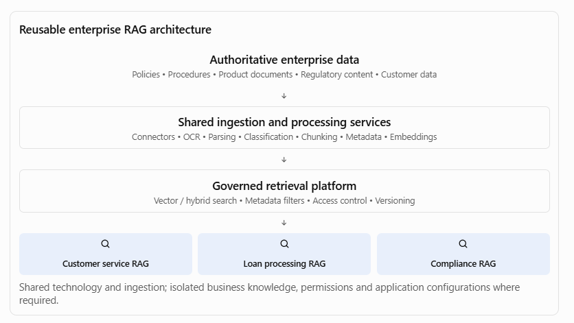
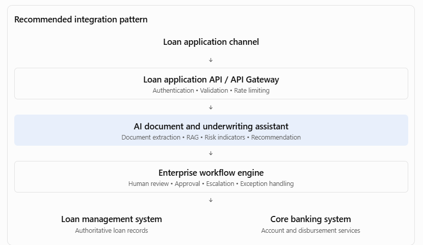

[Home](../../index.md) / [Expectation 7](index.md)

# 3. Application architecture decisions

> Part of Expectation 7: Guide architecture decisions across application, data, integration, platform, and operational concerns to avoid fragmented or duplicative solutions

### 3.1 What should be decided?

The objective is to prevent every team from independently building similar AI applications and business capabilities.

As Principal Architect, I would guide teams on:

### A. Application and domain boundaries

- Define clear business-domain ownership.
- Separate business logic from AI-specific orchestration.
- Avoid embedding business rules inside prompts.
- Define boundaries between user-facing applications, domain services, AI services, and enterprise systems.
- Use modular architecture and well-defined interfaces.

### B. Shared versus business-specific capabilities

Identify which capabilities should be enterprise-wide and which should remain specific to a business domain.

| **Shared enterprise capabilities** | **Business-specific capabilities** |
| --- | --- |
| Model access service | Loan underwriting rules |
| Prompt management | Claims assessment logic |
| RAG framework | Fraud investigation workflow |
| AI evaluation service | Customer retention decisions |
| Agent/tool registry | Regulatory interpretation workflow |
| AI audit service | Product-specific recommendations |

### C. Architecture patterns

Standardise appropriate patterns for:

- AI-enabled application architecture.
- RAG-based knowledge assistants.
- Agentic workflow applications.
- Human-in-the-loop decision workflows.
- AI-assisted decision support.
- AI-enabled legacy modernisation.

### 3.2 Industry examples

| **Industry** | **Application architecture decision** |
| --- | --- |
| Banking | Reuse a common AI document-processing capability across loan applications, KYC and compliance rather than developing separate extraction applications. |
| Insurance | Create reusable claims document assessment services while keeping policy-specific claims rules within individual product domains. |
| Healthcare | Share clinical document summarisation services but maintain separate workflows and access boundaries for clinical and administrative applications. |
| Telecom | Reuse customer interaction and knowledge-assistant capabilities across service channels while maintaining domain-specific billing and network workflows. |
| Government | Establish common citizen-service AI capabilities while keeping departmental case-management and statutory decision logic separate. |

Principal Architect perspective: Reuse the capability, not necessarily the entire application. Domain ownership, business rules, and accountability must remain clear.

## 4. Data architecture decisions

Data architecture is particularly important in AI programmes because AI solutions depend on reliable, governed, accessible, and appropriately protected enterprise data.

A common source of duplication is that every AI team independently creates its own document repository, data ingestion pipeline, embedding process, vector database, and retrieval mechanism.

### 4.1 What should be decided?

### A. Enterprise data ownership and data domains

Define authoritative sources for enterprise data.

For example:

| **Data domain** | **Potential authoritative source** |
| --- | --- |
| Customer information | Customer master / CRM |
| Account information | Core banking system |
| Loan information | Loan management system |
| Policy information | Policy administration system |
| Claims information | Claims management system |
| Employee information | HR system |
| Regulatory documents | Approved regulatory content repository |

AI applications should retrieve information from authorised sources rather than creating competing versions of enterprise data.

### B. Data ingestion and processing standards

Establish reusable patterns for:

- Structured data ingestion.
- Unstructured document ingestion.
- Data validation and cleansing.
- Metadata extraction and enrichment.
- Document classification.
- Chunking and embedding generation.
- Data lineage and version management.
- Data retention and deletion.

### C. Enterprise RAG architecture

A common RAG capability can support multiple business applications.

For example, a banking enterprise may have separate knowledge assistants for customer service, loan processing, and compliance. They may share document ingestion, embedding generation, retrieval infrastructure, and evaluation services while maintaining separate knowledge collections, access policies, and domain-specific retrieval configurations.

### D. Data security and access control

The retrieval architecture must enforce the source system's access permissions. A user who cannot access a confidential document in the original repository must not be able to retrieve it through an AI assistant.

Key controls include:

- Role-based and attribute-based access control.
- Document-level and, where required, chunk-level permissions.
- Tenant and business-unit isolation.
- Data classification and encryption.
- PII detection and masking where appropriate.
- Data residency and retention controls.
- Source attribution and lineage.

### 4.2 Industry examples

| **Industry** | **Data architecture decision** |
| --- | --- |
| Banking | Reuse customer and account data products across lending, customer service and relationship-management AI applications, subject to purpose-based access. |
| Insurance | Establish a governed policy and claims document ingestion capability rather than creating separate document pipelines for every claims application. |
| Healthcare | Use governed clinical data services with patient-level access restrictions and appropriate consent controls. |
| Telecom | Reuse customer, network and usage data products while maintaining separate access policies for customer-facing and network operations use cases. |
| Government | Establish common data cataloguing and metadata standards across departments while respecting statutory data-sharing restrictions. |

Principal Architect perspective: Data reuse does not mean unrestricted data sharing. Reuse must be governed by ownership, purpose, consent, access, quality, and regulatory requirements.

## 5. Integration architecture decisions

Integration architecture determines how AI applications communicate with enterprise systems, consume business capabilities, and execute actions.

This is particularly important in agentic AI, where an AI agent may need to retrieve customer information, create a service request, initiate a payment, or trigger an approval workflow.

### 5.1 What should be decided?

### A. API strategy

Define standard approaches for:

- Synchronous REST APIs.
- Asynchronous APIs.
- API gateways.
- API versioning.
- Authentication and authorisation.
- Rate limiting and throttling.
- API lifecycle management.
- Service contracts and error handling.

Avoid creating new APIs when an existing, governed enterprise API already provides the required business capability.

### B. Event-driven integration

Use events when business processes require asynchronous communication, loose coupling, and independent processing.

#### Examples:

- Loan application submitted.
- Insurance claim received.
- Customer complaint raised.
- Payment flagged for investigation.
- Regulatory document updated.

AI services can subscribe to relevant events, process them, and publish results without tightly coupling the AI application to the originating system.

### C. Agent and tool integration

Define an enterprise approach for AI agents to interact with business systems.

A tool should have:

- A clearly defined business purpose.
- A versioned interface and input/output schema.
- Identity and permission controls.
- Validation and business-rule enforcement.
- Timeout, retry, and error-handling behaviour.
- Audit logging.
- Approval requirements for high-impact actions.

For example, a loan-processing agent should not directly update the core banking database. It should invoke an approved loan-management API, which enforces the business rules and authorisation controls.

### D. Workflow integration

This is where BPM and workflow architecture become particularly valuable.

An AI agent can analyse a loan application, extract relevant information, identify missing documents, and recommend a decision. A workflow engine should manage task assignment, approval, exception handling, escalation, and final business-process state.

The agent should not become an uncontrolled replacement for the enterprise workflow engine.

### 5.2 Industry examples

| **Industry** | **Integration architecture decision** |
| --- | --- |
| Banking | Reuse customer, account and payment APIs for multiple AI applications rather than creating direct database integrations. |
| Insurance | Integrate claims AI with policy and claims systems through governed APIs and workflow events. |
| Healthcare | Integrate clinical AI with authorised healthcare systems using standards-based interfaces such as FHIR where applicable. |
| Telecom | Use event-driven integration between network monitoring, incident management and AI-based fault analysis. |
| Government | Establish API standards and shared integration services for citizen identity, case management and departmental workflows. |

### 5.3 Worked example: AI-enabled loan processing

This design separates AI reasoning, business process execution, and authoritative transaction processing. It also allows the bank to replace the AI model or orchestration framework without redesigning the core loan-management integration.

Principal Architect perspective: AI agents should consume governed business capabilities, not bypass enterprise integration and transaction controls.

## 6. Platform architecture decisions

Platform architecture is where the organisation establishes the reusable technical foundation for building, deploying, and operating AI applications.

The objective is to avoid every project selecting its own model provider, embedding service, vector database, orchestration framework, deployment infrastructure, and monitoring stack.

### 6.1 What should be decided?

### A. Enterprise AI platform strategy

Establish which platform capabilities should be centrally provided.

| **Platform capability** | **Architectural decision** |
| --- | --- |
| Model access | Approved model providers and model gateway |
| Model lifecycle | Model onboarding, evaluation, versioning and retirement |
| Prompt management | Central prompt repository and version control |
| Embeddings | Approved embedding models and service patterns |
| Vector search | Approved vector database and hybrid retrieval options |
| Agent orchestration | Approved orchestration patterns and frameworks |
| Tool registry | Governed enterprise tools and API contracts |
| Evaluation | Shared evaluation framework and test datasets |
| Observability | Common tracing, logging, metrics and dashboards |
| Security | Identity, secrets, encryption and policy enforcement |

### B. Model and provider abstraction

Avoid unnecessary dependence on a single model provider.

Establish a model gateway or abstraction layer to manage:

- Provider-specific connectivity.
- Model selection and routing.
- Authentication and secrets.
- Token usage and cost tracking.
- Rate limits.
- Model versioning.
- Fallback and availability policies.
- Safety and content filtering.

However, abstraction should not hide important model-specific capabilities. The architecture should retain the ability to use provider-specific features where there is a justified business or technical benefit.

### C. Compute and deployment strategy

Define appropriate infrastructure patterns for:

- Managed AI services.
- Container-based AI applications.
- Kubernetes-based deployments.
- Serverless workloads.
- GPU-intensive workloads.
- Private networking and hybrid connectivity.
- Development, testing, staging and production environments.

### D. Platform standardisation versus flexibility

Not every workload requires the same technology.

For example, a simple knowledge assistant may use a managed RAG service, whereas a complex multi-agent workflow may require a dedicated orchestration service with durable state management.

The Principal Architect should standardise interfaces, controls, and operational expectations without unnecessarily standardising every implementation detail.

### 6.2 Industry examples

| **Industry** | **Platform architecture decision** |
| --- | --- |
| Banking | Establish an enterprise AI platform with approved models, private connectivity, model gateway, RAG and audit capabilities. |
| Insurance | Provide reusable document intelligence, OCR, embedding and model evaluation services across claims and underwriting. |
| Healthcare | Use a controlled AI platform with appropriate data isolation, identity controls, model validation and clinical safety oversight. |
| Telecom | Provide shared AI infrastructure for network operations, customer support and predictive maintenance while supporting different performance requirements. |
| Government | Establish approved hosting, identity, model access and audit patterns for departments with different data classifications. |

Principal Architect perspective: Build an enterprise AI platform as a product with defined service ownership, service-level objectives, onboarding processes, support models, and measurable adoption—not merely as a collection of cloud services.

## 7. Operational architecture decisions

A solution is not enterprise-ready simply because it works in development. The architecture must also address how it will be deployed, monitored, supported, recovered, secured, and evolved.

### 7.1 What should be decided?

### A. Production operating model

Define:

- Application ownership.
- Platform ownership.
- Model and AI service ownership.
- L1, L2 and L3 support responsibilities.
- Incident and problem management.
- Change and release management.
- Service-level objectives and service-level agreements.

### B. AI-specific observability

Traditional application monitoring is not sufficient for AI workloads.

The architecture should monitor:

- API latency and availability.
- Model response latency.
- Token consumption and cost.
- Prompt and completion failures.
- Retrieval quality.
- Groundedness and citation accuracy.
- Agent task completion.
- Tool invocation failures.
- Safety-policy violations.
- Model quality drift.

### C. Resilience and recovery

Define patterns for:

- Model-provider failure.
- API failures.
- Vector database unavailability.
- Queue backlogs.
- Retry and timeout handling.
- Circuit breakers.
- Graceful degradation.
- Disaster recovery.
- Backup and restore.

For example, a customer-service assistant should be able to fall back to a conventional search experience or transfer the interaction to a human agent if the model service becomes unavailable.

### D. AI lifecycle and change management

A change to a prompt, model, embedding model, retrieval configuration, or agent tool can affect application behaviour.

Therefore, production changes should be controlled through:

- Versioned prompts and model configurations.
- Regression evaluation.
- Security and safety testing.
- Controlled rollout and rollback.
- Shadow or canary deployment where appropriate.
- Production feedback and continuous improvement.

### E. Cost and capacity management

Establish cost visibility at application, business-unit, model, and platform levels.

Use appropriate strategies such as model routing, caching, token optimisation, batching, workload scheduling, and quotas.

### 7.2 Industry examples

| **Industry** | **Operational architecture decision** |
| --- | --- |
| Banking | Define high availability, transaction auditability, fallback and operational controls for customer-facing AI services. |
| Insurance | Monitor claims-processing AI accuracy, processing delays, exception volumes and model drift. |
| Healthcare | Establish clinical safety escalation, human oversight and service continuity for clinical AI applications. |
| Telecom | Monitor AI-based network incident detection and ensure fallback to existing network operations procedures. |
| Government | Maintain service continuity, audit records, controlled releases and support accountability for citizen-facing AI services. |

Principal Architect perspective: A shared platform without a defined operating model can become another enterprise bottleneck. Every shared capability needs an owner, support model, service level, lifecycle policy, and cost model.

## 8. How to prevent fragmented and duplicative solutions

The Principal Architect should establish mechanisms that influence architecture decisions before teams commit to technology and implementation choices.

### 8.1 Establish an enterprise capability map

Create an inventory of existing and planned capabilities across business units.

For example:

| **Capability** | **Existing implementation** | **Proposed direction** |
| --- | --- | --- |
| LLM access | Three separate provider integrations | Shared model gateway |
| Document ingestion | Four independent pipelines | Reusable ingestion service |
| Embedding generation | Multiple implementations | Approved embedding service |
| Vector search | Separate databases per project | Governed shared or domain-isolated service |
| Prompt management | Prompts stored in source code | Versioned prompt management |
| AI evaluation | Manual testing | Shared evaluation framework |
| AI observability | Different monitoring tools | Common telemetry standards |
| Agent tools | Duplicated API wrappers | Governed tool registry |

The objective is not necessarily to consolidate every technology into one instance. It is to identify duplicated capabilities and determine whether they should be shared, federated, or retained independently.

### 8.2 Introduce architecture decision records

For significant architectural choices, require a documented decision.

An Architecture Decision Record (ADR) should capture:

1. Business and technical context.
1. Problem being addressed.
1. Options considered.
1. Evaluation criteria.
1. Selected decision.
1. Reasons for selecting it.
1. Trade-offs and consequences.
1. Security, privacy and compliance implications.
1. Reuse opportunities.
1. Review date and conditions for revisiting the decision.

#### Example: Should we build another vector database?

| **Evaluation question** | **What the architect should establish** |
| --- | --- |
| Is there an existing enterprise service? | Identify the current approved vector-search capability. |
| Does it meet the requirement? | Assess scale, latency, filtering, isolation and availability. |
| Is a new technology justified? | Identify concrete functional or non-functional gaps. |
| Can it integrate with existing controls? | Assess identity, encryption, monitoring and backup. |
| What is the total cost? | Include licensing, infrastructure, support and skills. |
| What is the long-term impact? | Assess portability, vendor lock-in and operational complexity. |

A new technology should be introduced only when the business or technical justification outweighs the additional complexity.

### 8.3 Establish architecture governance forums

| **Governance mechanism** | **Purpose** |
| --- | --- |
| Enterprise Architecture Review Board | Review strategic architecture decisions and alignment with target architecture. |
| AI Architecture Review Board | Review AI-specific architecture, model, RAG and agent patterns. |
| Security and Responsible AI Review | Review security, privacy, risk, fairness and responsible AI controls. |
| Technology Standards Forum | Approve technologies, reference architectures and standards. |
| Design Authority | Review solution designs, exceptions and material architectural deviations. |

Governance should be risk-based. A low-risk internal productivity assistant should not necessarily go through the same approval process as an AI system influencing credit decisions or clinical care.

### 8.4 Use architecture principles

I would establish a set of enterprise principles such as:

- Reuse before building.
- Buy or consume managed services where justified; build only where differentiation or control requires it.
- API-first integration.
- Data ownership remains with authoritative systems.
- Security and privacy by design.
- Human accountability for consequential business decisions.
- Model and provider portability where economically justified.
- Observability and auditability by design.
- Automate compliance and quality controls.
- Design for resilience and graceful degradation.

## Page navigation

- Next: [9. Worked enterprise case study: Banking AI transformation](exercises.md)
- [Back to Expectation 7](index.md)
- [Main index](../../index.md)
