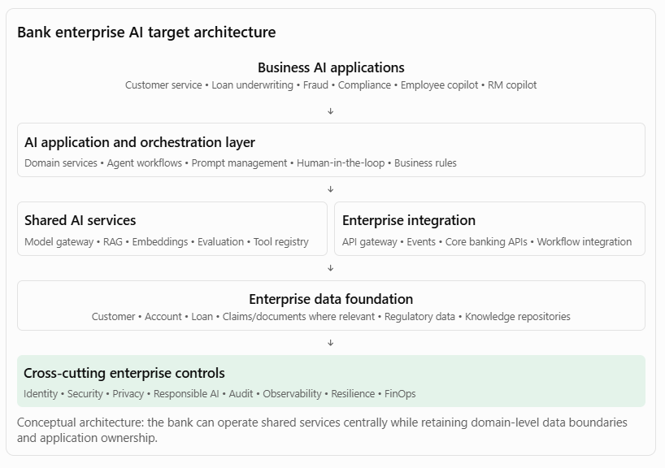

[Home](../../index.md) / [Expectation 7](index.md)

# 9. Worked enterprise case study: Banking AI transformation

> Part of Expectation 7: Guide architecture decisions across application, data, integration, platform, and operational concerns to avoid fragmented or duplicative solutions

Consider a bank that wants to implement six AI initiatives across Retail Banking, Corporate Banking, Risk, Compliance and Operations.

### 9.1 Initial situation

Different business units have started AI pilots independently.

| **Business unit** | **Initiative** | **Duplicated architecture** |
| --- | --- | --- |
| Retail Banking | Customer service assistant | LLM integration, RAG, knowledge store |
| Lending | Loan underwriting assistant | Document processing, RAG, model integration |
| Risk | Fraud investigation assistant | LLM integration, APIs, monitoring |
| Compliance | Regulatory knowledge assistant | Document ingestion, vector search |
| Operations | Employee knowledge assistant | RAG, prompt management |
| Corporate Banking | Relationship manager copilot | Customer APIs, LLM integration |

The bank is facing:

- Multiple model-provider contracts.
- Duplicated document processing.
- Inconsistent security controls.
- Separate vector databases.
- Different evaluation approaches.
- High operational support costs.
- Limited visibility into AI usage and expenditure.

### 9.2 Target-state architecture

### 9.3 Implementation approach

#### Phase 1 — Discover and assess

- Inventory existing AI initiatives.
- Identify duplicated technology and capabilities.
- Review current enterprise application, data and integration architecture.
- Assess security, regulatory and operational constraints.
- Identify opportunities for reuse.

#### Phase 2 — Define target architecture

- Establish enterprise AI reference architecture.
- Define shared versus domain-specific capabilities.
- Select approved model access and retrieval patterns.
- Define integration standards and tool contracts.
- Establish architecture principles and decision rights.

#### Phase 3 — Build shared foundations

- Implement model gateway.
- Establish common document ingestion services.
- Provide governed RAG and retrieval services.
- Implement evaluation and observability capabilities.
- Establish identity, security and audit controls.

#### Phase 4 — Migrate and onboard applications

- Prioritise initiatives based on business value and reuse potential.
- Onboard suitable pilots to shared services.
- Retire redundant components where appropriate.
- Retain specialised services where justified.
- Measure adoption and business outcomes.

#### Phase 5 — Operate and continuously evolve

- Monitor platform adoption, reliability and cost.
- Review exceptions and technology changes.
- Improve shared capabilities based on application feedback.
- Update reference architectures and standards.

### 9.4 How to measure success

The objective is not simply to reduce the number of technologies. It is to improve business delivery and enterprise technology effectiveness.

| **Dimension** | **Example KPI** |
| --- | --- |
| Reuse | Percentage of AI solutions using approved shared capabilities |
| Duplication | Number of redundant services and technology implementations retired |
| Delivery | Time required to onboard a new AI application |
| Cost | Cost per AI transaction or completed task |
| Integration | Percentage of integrations using approved enterprise APIs and events |
| Security | Percentage of AI applications meeting mandatory security controls |
| Reliability | Availability and recovery performance against agreed SLOs |
| Quality | Groundedness, task success and evaluation pass rates |
| Governance | Percentage of material architecture decisions documented and approved |

Targets should be set after measuring the current baseline. For instance, the bank might target a reduction in new application onboarding time by reusing the enterprise AI platform, but should not claim that benefit without measuring it.

## 10. Key architectural trade-offs a Principal Architect must understand

A strong architect does not simply mandate centralisation. The role is to choose the right level of standardisation and autonomy.

| **Architectural choice** | **When to prefer it** | **Main trade-off** |
| --- | --- | --- |
| Centralised AI platform | Common enterprise capabilities and consistent controls are needed | Can become a bottleneck |
| Federated AI platform | Business units have distinct needs or regulatory boundaries | Greater governance complexity |
| Shared vector database | Similar workloads and manageable isolation requirements | Shared capacity and failure-domain risks |
| Separate domain vector stores | Strong isolation, residency or workload requirements | More operational overhead |
| Central model gateway | Common security, routing and cost controls are required | Potential latency and dependency |
| Multiple model providers | Resilience, capability diversity or negotiation leverage matters | More integration and operational complexity |
| Synchronous API integration | Immediate response is required | Tighter runtime dependency |
| Event-driven integration | Loose coupling and asynchronous processing are suitable | Eventual consistency and more complex tracing |
| Workflow-led execution | Predictable processes, approvals and auditability are essential | Less flexibility for open-ended reasoning |
| Agent-led execution | Dynamic reasoning and tool selection provide genuine value | Less predictable execution and greater control requirements |

Important distinction: Standardise the enterprise contracts, controls, and engineering practices. Allow implementation choices to vary when measurable requirements justify the variation.

## Page navigation

- Previous: [3. Application architecture decisions](architecture-decisions.md)
- Next: [12. Interview questions to prepare](preparation.md)
- [Back to Expectation 7](index.md)
- [Main index](../../index.md)
