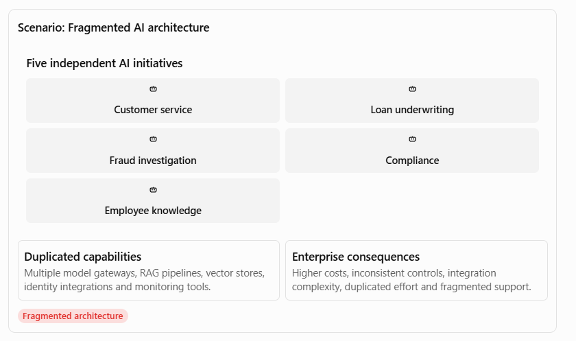
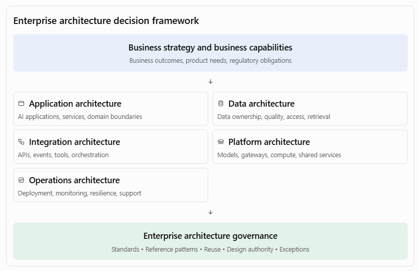

[Home](../../index.md)

# Expectation 7: Guide architecture decisions across application, data, integration, platform, and operational concerns to avoid fragmented or duplicative solutions

This is a key responsibility for an AI Principal Architect because enterprise AI initiatives often begin independently across business units. Different teams may select different LLM providers, build separate RAG pipelines, create overlapping APIs, maintain duplicate data stores, and introduce inconsistent security and operational practices. The result is an expensive and difficult-to-maintain technology landscape.

As an AI Principal Architect, I would establish an enterprise-wide architectural decision framework that considers application, data, integration, platform, and operational architecture together. My objective would be to maximise reuse, enforce appropriate standards, reduce duplication, and preserve business-unit flexibility where it is justified. I would guide teams toward shared capabilities and interoperable patterns while ensuring that each solution meets its business requirements for scalability, security, performance, resilience, cost, and maintainability.

## 1. What this responsibility means

This responsibility is about making sure that individual AI solutions fit into a coherent enterprise architecture rather than becoming isolated technology implementations.

Consider a large bank implementing five AI initiatives:

- Customer service virtual assistant.
- Loan underwriting copilot.
- Fraud investigation assistant.
- Regulatory compliance assistant.
- Employee knowledge assistant.

Without architectural direction, each team might independently procure an LLM, create a vector database, build document ingestion pipelines, implement authentication, and develop its own monitoring solution.

The Principal Architect should guide the organisation toward shared enterprise capabilities without forcing every business solution into an identical design.

## 2. Five architectural dimensions to govern

The five dimensions are interdependent. For example, choosing an agent framework affects application design, integration patterns, state management, observability, deployment, and operational support. A decision about vector storage affects data governance, retrieval performance, access control, and infrastructure costs.

## Pages in this expectation

- [3. Application architecture decisions](architecture-decisions.md) - Application, data, integration, platform, and operational decisions, plus preventing duplication.
- [9. Worked enterprise case study: Banking AI transformation](exercises.md) - A banking transformation case study and key architectural trade-offs.
- [12. Interview questions to prepare](preparation.md) - Interview questions, resources, and a seven-day preparation plan.
- [Interview positioning and final answer](positioning.md) - How to connect Appian experience and deliver the final interview-ready answer.

## Navigate

- Previous: [Expectation 6: Help engineering teams leverage AI-powered PDLC capabilities across coding, testing, documentation, analysis, and delivery workflows](../06-ai-powered-pdlc/index.md)
- Next: [Expectation 8: Participate in architecture reviews, technical strategy discussions, and investment decisions related to AI and platform modernization](../08-architecture-reviews-investment/index.md)
- [Main index](../../index.md)
