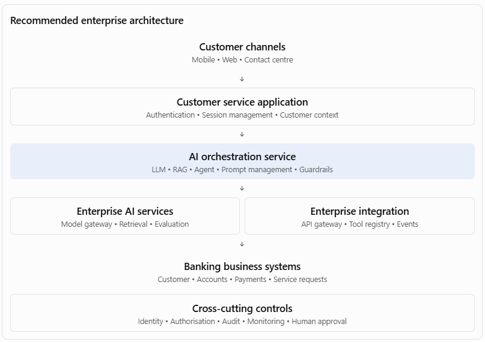
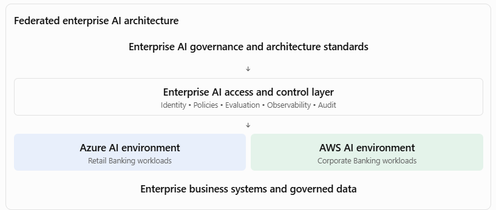
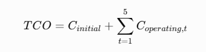
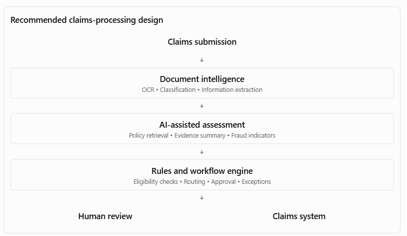

[Home](../../index.md) / [Expectation 8](index.md)

# Architecture review scenarios and mock interview

> Part of Expectation 8: Participate in architecture reviews, technical strategy discussions, and investment decisions related to AI and platform modernization

## 1. Scenario: Architecture review of an enterprise AI agent

#### Architecture review simulation

#### Situation

A bank's Retail Banking team proposes an AI-powered customer service agent.

The proposed solution:

- Uses an external LLM.
- Uses RAG to retrieve customer and product information.
- Connects to core banking APIs.
- Can initiate service requests and payment-related actions.
- Uses a separate vector database.
- Has its own monitoring and logging infrastructure.

The project team wants architecture approval to begin implementation.

### 1.1 What should you investigate?

As Principal Architect, I would not immediately approve the design. I would challenge the architecture across the following dimensions.

| **Area** | **Questions you should ask** |
| --- | --- |
| Business | What business problem is being solved? What is the expected benefit? |
| Application | Why is a separate application required? Can existing customer-service capabilities be reused? |
| AI | Why an agent rather than a conventional workflow with LLM assistance? |
| Data | What customer data can the agent access? How is access controlled? |
| Integration | Are existing banking APIs being reused? |
| Security | How are agent permissions and sensitive transactions controlled? |
| Platform | Why is a separate vector database required? |
| Operations | How will model failures, incorrect responses and tool failures be handled? |
| Financial | What is the five-year TCO? |

### 1.2 Identify architectural risks

Suppose the team provides these answers:

| **Team's proposal** | **Your architectural concern** |
| --- | --- |
| We will use the latest LLM. | Has it been evaluated against the business requirements? |
| We will build a new vector database. | Does an approved enterprise retrieval service already exist? |
| The agent can call banking APIs. | What permissions will it have? |
| The agent will handle customer transactions. | Where are business validation and authorisation performed? |
| We will create our own monitoring. | Can the enterprise observability platform be reused? |
| We will store prompts in application code. | How will prompt versioning and regression testing work? |

### 1.3 Your recommended architecture

#### Key architectural decisions:

- Use an approved enterprise model gateway.
- Reuse enterprise retrieval services where suitable.
- Enforce customer permissions at retrieval time.
- Allow the agent to invoke only approved business tools.
- Keep financial transaction authorisation within existing banking services.
- Use workflow management for approvals and exceptions.
- Implement end-to-end AI observability.

### 1.4 How you defend this decision before the architecture board

#### Your response:

"I would support the business objective, but I would recommend some architectural changes before approval.

My primary concern is that the proposed design introduces several capabilities that may already exist at enterprise level. I would first establish whether the model gateway, document retrieval, API integration and observability capabilities can be reused.

I would also separate AI reasoning from transactional business execution. The agent can understand customer intent, retrieve relevant information and propose an action, but the actual transaction must go through an authorised banking service that validates permissions, business rules and transaction limits.

This approach gives us the flexibility to evolve the AI implementation without compromising the bank's existing transaction controls. It also reduces duplication and creates reusable capabilities for future AI applications."

## 2. Scenario: Two business units want different AI platforms

Enterprise technology strategy

#### Situation

Two business units approach the CTO with different proposals.

- Retail Banking wants Microsoft Azure AI services.
- Corporate Banking wants AWS Bedrock and its associated AI services.

Both business units have valid requirements. The CTO asks you:

"Should we standardise on one AI platform, or allow different platforms across the enterprise?"

This is a typical Principal Architect strategic decision.

### 2.1 Understand the requirements before deciding

I would compare the requirements across several dimensions.

| **Dimension** | **Retail Banking** | **Corporate Banking** |
| --- | --- | --- |
| Main use cases | Customer service, personal banking | Relationship management, document intelligence |
| Data sensitivity | High | High |
| Existing cloud footprint | Azure-heavy | AWS-heavy |
| Integration | Core banking, CRM | Corporate banking, document systems |
| AI workloads | Customer-facing assistants | Complex document and workflow processing |
| Regulatory requirements | Banking controls | Banking controls |
| Platform skills | Azure engineering | AWS engineering |

### 2.2 Evaluate three strategic options

Option A — Standardise on one cloud AI platform

Best when requirements are substantially common

- Consistent governance.
- Easier central platform management.
- Potential economies of scale.
- Less technology fragmentation.

Risks: Migration costs, unsuitable fit for some workloads, concentration risk and potential lock-in.

Option B — Allow each business unit to choose independently

- Maximum business-unit flexibility.
- Can leverage existing cloud investments.
- Potentially faster delivery.

Risks: Duplicate capabilities, inconsistent governance, fragmented skills and increased operating costs.

Option C — Federated enterprise AI architecture

Often a strong candidate

- Common enterprise architecture standards.
- Common security and responsible AI controls.
- Shared interfaces and governance.
- Multiple approved cloud AI platforms where justified.

Risks: More complex governance, integration and platform operations.

### 2.3 My recommended approach

I would generally evaluate a federated architecture before enforcing a single-provider strategy.

The enterprise should standardise:

- Model access governance.
- Security and identity standards.
- AI evaluation requirements.
- Prompt and model lifecycle management.
- Observability.
- Auditability.
- API and agent tool contracts.
- Data protection and responsible AI controls.

However, the underlying model provider or cloud service can differ where there is a defensible business, regulatory or technical requirement.

### 2.4 How to defend this decision before the CTO

"I would avoid making a cloud-provider decision purely on standardisation grounds.

I would first evaluate the existing cloud footprint, data residency requirements, security architecture, AI service capabilities, operational maturity, cost and vendor dependency.

My preference would be to standardise enterprise governance, security, model access contracts and operational controls, while allowing multiple approved platforms where justified.

This provides a balance between enterprise consistency and business-unit flexibility. I would also establish clear criteria for introducing an additional platform, so that multi-cloud does not become an excuse for uncontrolled technology proliferation."

Principal-level insight: Multi-cloud is not automatically a good strategy. It must have a clear business or architectural justification and an operating model capable of managing the resulting complexity.

## 3. Scenario: The CTO asks you to define a three-year AI and platform modernisation roadmap

Technical strategy

#### Situation

The CTO says:

"We have several legacy applications, fragmented integration platforms, growing AI demand and increasing technology costs. What should our technology roadmap look like for the next three years?"

You need to move beyond individual solution recommendations and articulate an enterprise transformation strategy.

### 3.1 Begin with a current-state assessment

I would evaluate five dimensions.

| **Dimension** | **Typical problem** |
| --- | --- |
| Applications | Legacy monoliths, duplicated functionality and technical debt |
| Data | Silos, inconsistent quality and limited data accessibility |
| Integration | Point-to-point interfaces and inconsistent APIs |
| AI | Isolated pilots, inconsistent model selection and no shared AI platform |
| Operations | Limited observability, manual deployments and high operational effort |

I would also evaluate business impact, technical risk, regulatory exposure and the cost of maintaining the existing landscape.

### 3.2 Define the target-state vision

A possible vision could be:

"Create a modern, secure and AI-enabled enterprise technology platform that allows business units to deliver digital capabilities faster through reusable services, governed data, intelligent automation and scalable cloud infrastructure."

### 3.3 Create a three-year roadmap

#### Three-year AI and platform modernisation roadmap

Year 1 — Foundation

Stabilise and standardise

- Current-state assessment.
- Enterprise architecture principles.
- API and integration standards.
- AI platform foundation.
- Identity and security modernisation.
- Priority legacy platform stabilisation.
- AI governance and evaluation framework.

Year 2 — Modernisation

Transform and integrate

- Legacy application modularisation.
- Enterprise data products.
- Shared RAG and agent services.
- Event-driven integration.
- AI-powered PDLC.
- Workflow automation.
- Common observability and FinOps.

Year 3 — Scale and optimise

Industrialise and evolve

- Enterprise AI adoption at scale.
- Agentic workflow expansion.
- Predictive and intelligent operations.
- Legacy platform retirement.
- Continuous architecture optimisation.
- Cost and performance optimisation.
- Benefits realisation.

### 3.4 How would you prioritise?

Not all modernisation initiatives should start at the same time.

I would use a prioritisation model based on:

1. Business value.
1. Regulatory and security risk.
1. Technology obsolescence.
1. Dependency on other initiatives.
1. Reuse potential.
1. Cost and implementation complexity.

For example, API modernisation may need to precede AI agent adoption because agents require reliable and governed enterprise interfaces.

### 3.5 How to defend the roadmap before the CTO

"I would not recommend treating AI adoption and platform modernisation as separate programmes.

The success of enterprise AI depends on the quality of the underlying application, data, integration, security and operational architecture.

My recommendation would be to establish the enterprise foundations first, modernise the highest-priority platforms in parallel, and then scale AI use cases on top of those foundations.

I would use a phased roadmap with measurable milestones. This allows us to demonstrate early value without creating additional technical debt or making large irreversible technology commitments prematurely."

## 4. Scenario: The investment committee asks whether to build or buy an enterprise AI platform

Technology investment decision

#### Situation

The CIO has received three proposals:

- Proposal A: Build an enterprise AI platform internally.
- Proposal B: Purchase a commercial AI platform.
- Proposal C: Use managed AI services from the existing cloud provider and develop only the required enterprise integration and governance layers.

The investment committee asks you to recommend one.

### 4.1 Build an investment assessment

I would evaluate the proposals against the following dimensions.

| **Criteria** | **Weight** |
| --- | --- |
| Business and strategic alignment | 20% |
| Functional and technical capability | 15% |
| Security and compliance | 15% |
| Five-year TCO | 15% |
| Integration and interoperability | 10% |
| Scalability and performance | 10% |
| Vendor dependency and portability | 5% |
| Operational maturity | 5% |
| Time to value | 5% |
| Total | 100% |

### 4.2 Illustrative weighted assessment

Scores are out of 5. Higher is better.

| **Criterion** | **Build** | **Buy** | **Managed services** |
| --- | --- | --- | --- |
| Strategic alignment | 5 | 3 | 4 |
| Functional capability | 3 | 5 | 4 |
| Security/compliance | 4 | 4 | 4 |
| Five-year TCO | 2 | 3 | 4 |
| Integration | 4 | 3 | 4 |
| Scalability | 4 | 4 | 5 |
| Portability | 5 | 2 | 3 |
| Operational maturity | 2 | 4 | 4 |
| Time to value | 2 | 5 | 4 |
| Weighted score / 100 | 71 | 73 | 81 |

Illustrative scoring, not a market assessment. Actual scores require vendor demonstrations, security assessment, pricing, reference checks and workload testing.

Illustrative weighted evaluation scores for three AI platform investment options.

0/10025/10050/10075/100100/100BuildBuyManaged services

### 4.3 Understand the TCO

A common mistake is comparing only the initial implementation cost.

A proper five-year TCO should include:

Where initial and operating costs include:

- Platform development or licensing.
- Cloud compute and storage.
- LLM inference and embeddings.
- Vector database.
- Integration development.
- Security and compliance.
- Engineering and support teams.
- Monitoring and observability.
- Upgrades and maintenance.
- Migration and eventual exit costs.

I would also assess opportunity cost: how much time and money would internal engineering spend building capabilities already available as managed services?

### 4.4 How to defend your recommendation

"My recommendation would be based on strategic differentiation and the economics of ownership.

I would not build an entire AI platform from scratch if the majority of capabilities are already available through mature managed services.

I would evaluate a managed-services-led approach with an enterprise-controlled architecture layer. This would allow us to use mature model and infrastructure services while retaining control over enterprise identity, governance, data access, orchestration contracts, evaluation and observability.

However, if the organisation has specialised requirements around data residency, model control, latency or proprietary intellectual property, I would consider self-hosted or custom-built components selectively.

The objective is to invest engineering effort where it creates genuine enterprise value rather than recreating commodity technology."

## 5. Scenario: A project team wants to use multi-agent AI, but you believe it is unnecessarily complex

Technical challenge and architectural judgement

#### Situation

An engineering team proposes a multi-agent solution for insurance claims assessment.

They want:

- A document agent.
- A policy agent.
- A fraud agent.
- A decision agent.
- A workflow agent.
- A supervisor agent.

The team claims that this is an advanced, future-ready architecture.

The business problem is relatively straightforward: process claims documents, verify policy conditions, identify potential fraud indicators, and send claims for assessment.

### 5.1 Challenge the proposed design

I would ask:

1. Does each agent have a genuinely distinct responsibility?
1. Are the agents independently reasoning or simply calling APIs?
1. Does the problem require autonomous planning?
1. Can the workflow be represented through deterministic business processes?
1. What is the additional latency and token cost?
1. How will we trace decisions across agents?
1. How will we manage failures and inconsistent agent outputs?
1. Can we demonstrate better business outcomes than a simpler architecture?

### 5.2 Compare architectural alternatives

| **Option** | **Description** | **Suitability** |
| --- | --- | --- |
| Conventional workflow | Deterministic workflow with API and rules integration | Good for predictable processes |
| LLM-assisted workflow | LLM extracts information and supports specific decisions; workflow controls execution | Strong candidate for structured claims processes |
| Single agent | One agent invokes approved tools and reasons across tasks | Useful for moderate complexity |
| Multi-agent | Multiple specialised agents collaborate | Appropriate where independent capabilities and coordination justify the complexity |

### 5.3 My recommended approach

I would initially recommend an LLM-assisted workflow rather than immediately adopting a multi-agent architecture.

This approach offers predictable execution, clear accountability and easier auditability. We can introduce specialised agents later if measurable evidence demonstrates that they improve performance.

### 5.4 How to defend this decision

"I would not equate architectural sophistication with architectural quality.

My responsibility is to select the simplest architecture that adequately addresses the business requirements and non-functional constraints.

For this claims process, many activities are deterministic: policy validation, approval thresholds, task routing and claims status updates. These should remain within governed business services and workflow engines.

AI can add significant value in document interpretation, unstructured information extraction and evidence summarisation. I would introduce autonomous agent collaboration only where the use case demonstrates a genuine need for dynamic reasoning and where we can control its permissions, execution and failure behaviour."

## 8. Mock CIO/CTO interview: Test your decision-making

Let's test whether you can defend your decisions at Principal Architect level.

I'll act as the CTO. You respond as the AI Principal Architect.

#### Scenario: Enterprise AI investment

Executive challenge

CTO:

"We have six business units asking for AI funding. Each unit wants to use a different LLM provider and build its own AI application platform.

The business leaders argue that centralising AI will slow them down. The CFO is concerned about duplicated expenditure, and the CISO is concerned about inconsistent security and data governance.

I want you to recommend an enterprise architecture and investment strategy.

You have five minutes to present your recommendation."

#### Your response should address:

1. What architecture strategy would you recommend?
1. What would you centralise and what would remain with business units?
1. How would you balance speed of delivery with enterprise governance?
1. How would you prioritise investments?
1. How would you demonstrate the financial and business benefits?
1. What risks and trade-offs would you highlight?

## Page navigation

- Next: [6. Your Principal Architect decision-making framework](preparation.md)
- [Back to Expectation 8](index.md)
- [Main index](../../index.md)
